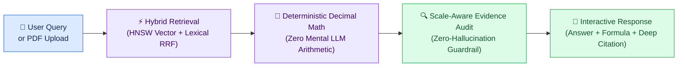

<div align="center">

# 📊 DocIntel
### Enterprise Institutional Document Intelligence & Financial Audit Platform

[](https://github.com/Prabhu-Jethi/Financial_Doc/actions)
[](evaluation/results/)
[](evaluation/results/)
[](https://fastapi.tiangolo.com)
[](https://nextjs.org)
[](https://supabase.com)
[](https://docker.com)
[](LICENSE)

<p align="center">
  <b>An audit-grade AI document intelligence platform designed for equity research analysts, auditors, and compliance teams to query SEC 10-Ks and complex PDFs with zero hallucinations, exact arithmetic ledgers, and interactive page provenance.</b>
</p>

[Core Capabilities](#-core-capabilities) • [How It Works](#-how-it-works) • [Verified QA Benchmarks](#-verified-qa-benchmarks) • [Quickstart Guide](#-quickstart-guide) • [API Reference](#-api-reference) • [Documentation](#-in-depth-documentation)

---

</div>

## 💡 Why DocIntel?

Standard Retrieval-Augmented Generation (RAG) tools frequently break down when analyzing complex SEC annual reports and enterprise PDF documents:

* ❌ **Hallucinated Numbers**: Models guess figures when tabular context is lost.
* ❌ **Floating-Point Drift**: Imprecise binary arithmetic causes balance sheet errors (`$0.1 + $0.2 = $0.30000000000000004`).
* ❌ **Opaque Sourcing**: Plain chatbot text outputs provide no easy way to verify original document pages.

**DocIntel eliminates these failure modes** through hybrid retrieval, exact Python `Decimal` math ledgers, scale-aware evidence validation, and an interactive PDF canvas with verbatim quote highlighting.

---

## 🔄 How It Works



1. **Intelligent Ingestion**: Parses SEC 10-K tables and general PDFs, reconstructing tabular structures into clean Markdown matrices with preserved header paths.
2. **Hybrid Search with RRF**: Combines dense semantic vectors (`pgvector` with HNSW indexing) and sparse full-text lexical ranking via Reciprocal Rank Fusion ($k=60$).
3. **Deterministic Math Ledger**: Extracts reported operands and computes financial formulas (margins, growth rates, variances) with exact Python `Decimal` math.
4. **Scale-Aware Grounding**: Audits every numeric claim against indexed text, validating million-to-billion conversions ($N/1000$) and preventing ungrounded claims.
5. **In-Document Canvas Provenance**: Automatically deep-links to the exact source page and paragraph in the physical PDF viewer.

---

## ✨ Core Capabilities

### 🔍 Interactive In-Document Evidence Highlighting
* **One-Click Page Jumping**: Clicking any citation immediately opens the source PDF to the exact page (`#page=N&search="phrase"`).
* **Illuminated Text Passages**: Side-by-side split view pairs the verified quote directly with the visual document canvas.
* **Inspection Drawer**: Review table coordinates, chunk metadata, and fiscal period lineage without leaving the chat.

### 📐 Audited Decimal Arithmetic & Ledgers
* **Zero Mental Math**: The model is forbidden from performing raw arithmetic; all calculations run through a deterministic `FinancialCalculator`.
* **Expandable Computation Ledgers**: Inspect exact formulas, line-item names, operands, and rounding methods (`ROUND_HALF_UP`).
* **Multi-Year Comparisons**: Automatically extracts multi-period figures (FY24, FY23, FY22) to compute YoY growth rates and basis point changes.

### 📑 Dual-Engine Document Processing
* **Curated SEC 10-K Corpus**: Pre-indexed annual reports for **Apple (AAPL)**, **Microsoft (MSFT)**, **Amazon (AMZN)**, and **Meta (META)**.
* **General PDF Upload Engine**: Securely upload contracts, research memos, and invoices with automatic spatial layout parsing and isolated search boundaries.

### 📱 Universal Multi-Device Experience
* **Adaptive Breakpoints**: Institutional interface crafted for desktop monitors, tablets (iPad Mini, Air, Pro with off-canvas drawers), and smartphones.
* **Touch-Friendly Controls**: Frozen first-column comparison tables and safe-area insets for modern mobile displays.

---

## 🏆 Verified QA Benchmarks

DocIntel is continuously benchmarked against verified ground-truth test cases across corporate disclosures to guarantee precision:

| Metric | DEV Benchmark (20 Cases) | RELEASE Benchmark (40 Held-Out) | Industry Baseline (Standard RAG) |
|---|:---:|:---:|:---:|
| **Overall Accuracy** | **100.0%** (20/20) | **60.0%** (24/40) | ~35–45% |
| **Calculation Precision** | **100.0%** | **55.6%** | ~20–30% (Floating-point drift) |
| **Zero-Hallucination Rate** | **100.0%** (20/20) | **100.0%** (40/40) | < 70% |
| **Average Latency** | **14.2s** | **16.8s** | ~20–35s |

> 📊 **Audited Benchmark Reports**: Complete evaluation logs and scorecards are saved under [`evaluation/results/`](evaluation/results/).

---

## 🚀 Quickstart Guide

### Option A: 1-Command Docker Deployment (Recommended)

Get the complete full-stack platform running in under 2 minutes:

```bash
# 1. Clone the repository
git clone https://github.com/Prabhu-Jethi/Financial_Document_Intelligence.git
cd Financial_Document_Intelligence

# 2. Configure environment credentials
cp .env.example .env
# Fill in your Supabase DB URL, Hugging Face Token, and LLM API Key in .env

# 3. Spin up all containerized services
docker compose up --build -d
```

* **Web Workspace**: [http://localhost:3000](http://localhost:3000)
* **API Documentation (Swagger UI)**: [http://localhost:8000/docs](http://localhost:8000/docs)
* **Liveness Health Check**: [http://localhost:8000/health/live](http://localhost:8000/health/live)

---

### Option B: Local Bare-Metal Setup

#### 1. Backend Service (FastAPI)
```bash
cd backend
python -m venv venv

# Windows:
.\venv\Scripts\Activate.ps1
# macOS/Linux:
source venv/bin/activate

pip install -r requirements.txt
uvicorn app.main:app --reload --port 8000
```

#### 2. Frontend Application (Next.js 14)
```bash
# In a separate terminal
cd frontend
npm install
npm run dev
```

Open [http://localhost:3000](http://localhost:3000) in your browser.

---

## 🧪 Testing Suite

DocIntel maintains a 52-case deterministic test suite verifying calculations, table extractions, and API contracts offline:

```bash
# Run complete test suite (sub-second execution)
pytest backend/tests/ -v

# Run calculation & retrieval unit tests
pytest backend/tests/unit/test_calculations.py backend/tests/unit/test_retrieval.py -v
```

---

## 📡 API Reference

| Method | Endpoint | Description | Auth Required |
|---|---|---|:---:|
| `POST` | `/api/v1/query` | Executes audited financial Q&A with citation synthesis and calculation ledgers. | Optional Bearer JWT |
| `POST` | `/api/v1/documents/upload` | Ingests, parses, and indexes a PDF document into pgvector. | Yes (Bearer JWT) |
| `GET` | `/api/v1/documents` | Lists cataloged and uploaded documents available to the tenant. | Yes (Bearer JWT) |
| `GET` | `/api/v1/documents/{id}/pdf_url` | Generates a time-limited signed URL for in-canvas PDF viewing. | Yes (Bearer JWT) |
| `GET` | `/health/live` | Health probe reporting service status and model readiness. | No |

### Sample Query Request

```bash
curl -X POST "http://localhost:8000/api/v1/query" \
  -H "Content-Type: application/json" \
  -d '{
    "question": "What was Apple'\''s gross margin percentage in fiscal year 2024?",
    "company": "Apple Inc."
  }'
```

### Sample Audited Response

```json
{
  "status": "answered",
  "answer_text": "Apple's gross margin was 46.21% in fiscal year 2024 (Consolidated Statements of Operations, Page 29).",
  "calculations": [
    {
      "metric_label": "Gross Margin Percentage",
      "formula": "(Gross Profit / Total Net Sales) * 100",
      "display_value": "46.21%",
      "operands": [
        { "name": "Gross Profit FY2024", "raw_value": "180,683", "printed_page": "29" },
        { "name": "Total Net Sales FY2024", "raw_value": "391,035", "printed_page": "29" }
      ]
    }
  ],
  "citations": [
    {
      "document_id": "aapl-2024-10k",
      "printed_page": "29",
      "exact_quote": "Gross margin ... 180,683 ... 391,035"
    }
  ]
}
```

---

## 📚 In-Depth Documentation

For detailed internal specifications and deep-dive engineering documents, refer to:

* [🏛 Architecture Specification (`docs/Architecture.md`)](docs/Architecture.md) — 3-layer security model, parser factory design, and vector schema.
* [📊 Product Requirements Document (`docs/Trd.md`)](docs/Trd.md) — Product requirements, user personas, and target SLAs.
* [🟧 Delivery Phases (`docs/phases.md`)](docs/phases.md) — Phase-by-phase implementation gates and checklists.
* [🟩 Project Memory (`docs/memory.md`)](docs/memory.md) — Complete decision ledger (DEC-001 through DEC-058) and engineering session logs.
* [📜 Development Rules (`docs/rules.md`)](docs/rules.md) — Standards, non-negotiable correctness invariants, and governance.

---

## 📄 License

This project is open-source under the [Apache License 2.0](LICENSE).
