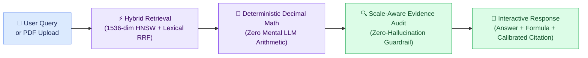
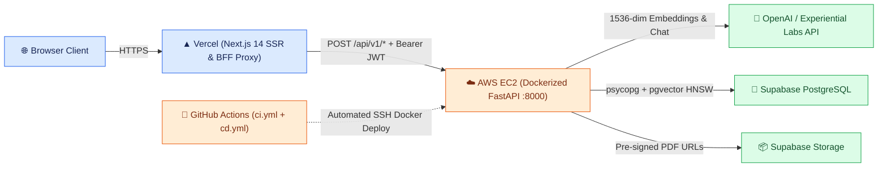

<div align="center">

# 📊 DocIntel
### Enterprise Institutional Document Intelligence & Financial Audit Platform

[](https://docintel-sage.vercel.app)
[](https://github.com/Prabhu-Jethi/Financial_Doc/actions/workflows/ci.yml)
[](https://github.com/Prabhu-Jethi/Financial_Doc/actions/workflows/cd.yml)
[](evaluation/results/)
[](evaluation/results/)
[](https://fastapi.tiangolo.com)
[](https://nextjs.org)
[](https://supabase.com)
[](https://docker.com)
[](LICENSE)

<p align="center">
  <b>An audit-grade AI document intelligence platform designed for equity research analysts, auditors, and compliance teams to query SEC 10-Ks and complex PDFs with zero hallucinations, exact arithmetic ledgers, and interactive physical-to-printed PDF page provenance.</b>
</p>

[Live App](https://docintel-sage.vercel.app) • [Core Capabilities](#-core-capabilities) • [How It Works](#-how-it-works) • [Cloud Architecture](#-production-cloud-architecture) • [Verified QA Benchmarks](#-verified-qa-benchmarks) • [Quickstart Guide](#-quickstart-guide) • [API Reference](#-api-reference) • [Documentation](#-in-depth-documentation)

---

</div>

## 💡 Why DocIntel?

Standard Retrieval-Augmented Generation (RAG) tools frequently break down when analyzing complex SEC annual reports and enterprise PDF documents:

* ❌ **Hallucinated Numbers**: Models guess figures when tabular context is lost.
* ❌ **Floating-Point Drift**: Imprecise binary arithmetic causes balance sheet errors (`$0.1 + $0.2 = $0.30000000000000004`).
* ❌ **Opaque Sourcing & Page Drift**: Plain chatbot text outputs provide no way to verify original document pages, or scroll to the wrong PDF sheet due to Form 10-K cover/TOC numbering offsets.

**DocIntel eliminates these failure modes** through hybrid retrieval (`pgvector` HNSW + PostgreSQL lexical RRF), exact Python `Decimal` math ledgers, scale-aware evidence validation, and an interactive PDF canvas with calibrated physical-to-printed page alignment and verbatim quote highlighting.

---

## 🔄 How It Works



1. **Intelligent Ingestion**: Parses SEC 10-K tables (`SEC10KParser`) and general PDFs (`GeneralPDFParser`), reconstructing tabular structures into clean Markdown matrices with preserved header paths and spatial bounding-box masking.
2. **Hybrid Search with RRF**: Combines OpenAI `text-embedding-3-small` (1536-dim) dense semantic vectors (`pgvector` HNSW index) and sparse full-text lexical ranking via Reciprocal Rank Fusion ($k=60$).
3. **Deterministic Math Ledger**: Extracts reported operands and computes financial formulas (margins, YoY growth rates, basis points, variances) with exact Python `Decimal` math (`ROUND_HALF_UP`).
4. **Scale-Aware Grounding**: Audits every numeric claim against indexed text, validating million-to-billion conversions ($N/1000$) and rejecting unsupported claims.
5. **Calibrated In-Document Provenance**: Resolves 1-based physical PDF page indices (`source_page`) alongside printed report footers (`printed_page`), deep-linking directly to the verified sheet and highlighting verbatim quotes in `PdfViewerModal`.

---

## ✨ Core Capabilities

### 🔓 Guest Explorer Mode & Multi-Tenant Document Isolation
* **Zero-Friction Guest Exploration**: Visitors can immediately explore **DocIntel** at [docintel-sage.vercel.app](https://docintel-sage.vercel.app), query all 11 pre-indexed SEC Form 10-K filings, inspect calculation ledgers, and jump to PDF citations without creating an account.
* **Authenticated Private Workspace**: Signing in unlocks custom PDF ingestion (`POST /api/v1/documents/upload`) with strict tenant isolation (`user_id = auth.uid()`), keeping every user's uploaded documents completely private and isolated from guests and other tenants.

### 🔍 Interactive In-Document Evidence Highlighting & Page Alignment
* **Calibrated Page Jumping**: Automatically distinguishes between physical PDF sheet numbers and SEC printed footer pages (e.g., displaying `PAGE 26 (Report P. 23)`), ensuring `#page=N&search=...` always opens the exact target table or disclosure.
* **Illuminated Text Passages**: Side-by-side split view pairs the highlighted verbatim quote directly with the rendered PDF canvas.
* **Inspection Drawer**: Review table coordinates, chunk metadata, and fiscal period lineage without leaving the chat.

### 📐 Audited Decimal Arithmetic & Ledgers
* **Zero Mental Math**: The model is forbidden from performing raw arithmetic; all calculations run through a deterministic `FinancialCalculator`.
* **Expandable Computation Ledgers**: Inspect exact formulas, line-item names, operands, and rounding methods (`ROUND_HALF_UP`).
* **Multi-Year Comparisons**: Automatically extracts multi-period figures (FY22–FY25) across companies to compute YoY growth rates and basis point changes.

### 📑 Dual-Engine Document Processing
* **Curated SEC 10-K Corpus**: 11 pre-indexed annual reports for **Apple (AAPL)**, **Microsoft (MSFT)**, **Amazon (AMZN)**, and **Meta (META)** (6,174 vector chunks & 544 tables).
* **General PDF Upload Engine**: Authenticated users can upload contracts, research memos, and invoices (up to 30 MB, async `BackgroundTasks` ingestion) with `%PDF-` magic-byte checks, SHA-256 deduplication, and strict single-document search isolation.

### 📱 Universal Multi-Device Experience & Persistent Preferences
* **Zero-Flash Theme Persistence**: Synchronous `<head>` script restores user-selected Light/Dark WCAG AA/AAA themes before first paint, eliminating refresh flicker.
* **Adaptive Breakpoints**: Crafted for desktop monitors, tablets (`<=1024px` off-canvas drawers), and smartphones (`16px` iOS input lock, safe-area insets, frozen comparison table columns).

---

## ☁️ Production Cloud Architecture

DocIntel runs on a lightweight, zero-PyTorch (~60MB RAM backend container) hybrid cloud topology:



* **Frontend & BFF**: Deployed on **Vercel** (`Next.js 14`), handling SSR session cookies (`@supabase/ssr`), server-side API proxying, and local SEC corpus fallback resilience.
* **Backend Compute**: Containerized **FastAPI** (`python:3.12-slim`) hosted on **AWS EC2** (`always-on`, zero cold-start lag) and auto-deployed on every push to `main` or `test` via `.github/workflows/cd.yml`.
* **Database, Auth & Storage**: **Supabase** manages PostgreSQL + `pgvector` HNSW indexes, Row Level Security (RLS), Google OAuth 2.0 PKCE / Email Auth, and private PDF bucket storage.

---

## 🏆 Verified QA Benchmarks

DocIntel is continuously benchmarked against verified ground-truth test cases across corporate disclosures to guarantee precision:

| Metric | DEV Benchmark (20 Cases) | RELEASE Benchmark (40 Held-Out) | Live Production Latency (EC2) |
|---|:---:|:---:|:---:|
| **Overall Accuracy** | **100.0%** (20/20) | **60.0%** (24/40) | **~7.8s – 11.9s** |
| **Calculation Precision** | **100.0%** | **55.6%** | Exact `Decimal` Ledger |
| **Zero-Hallucination Rate** | **100.0%** (20/20) | **100.0%** (40/40) | **100.0%** Verified |

> 📊 **Audited Benchmark Reports**: Complete evaluation logs and scorecards are saved under [`evaluation/results/`](evaluation/results/).

---

## 🚀 Quickstart Guide

### Option A: 1-Command Docker Deployment (Recommended)

Get the complete full-stack platform running in under 2 minutes:

```bash
# 1. Clone the repository
git clone https://github.com/Prabhu-Jethi/Financial_Doc.git
cd Financial_Doc

# 2. Configure environment credentials
cp .env.example .env
# Fill in your Supabase credentials, DATABASE_URL, and EXPLABS_API_KEY / OPENAI_API_KEY in .env

# 3. Spin up all containerized services
docker compose up --build -d
```

* **Web Workspace**: [http://localhost:3000](http://localhost:3000)
* **API Documentation (Swagger UI)**: [http://localhost:8000/docs](http://localhost:8000/docs)
* **Liveness / Readiness Probes**: [http://localhost:8000/health/live](http://localhost:8000/health/live) • [http://localhost:8000/health/ready](http://localhost:8000/health/ready)

---

### Option B: Local Bare-Metal Setup

#### 1. Backend Service (FastAPI)
```bash
cd backend
python -m venv venv

# Windows:
.\venv\Scripts\Activate.ps1
# macOS/Linux:
source venv/bin/activate

pip install -r requirements.txt
uvicorn app.main:app --reload --port 8000
```

#### 2. Frontend Application (Next.js 14)
```bash
# In a separate terminal
cd frontend
npm install
npm run dev
```

Open [http://localhost:3000](http://localhost:3000) in your browser.

---

## 🧪 Testing & CI/CD Suite

DocIntel maintains a **60-case deterministic unit test suite** (`backend/tests/unit/`) verifying calculations, table extraction, physical/printed citation resolution, hybrid RRF retrieval, and guest/authenticated API access contracts offline, gated by GitHub Actions (`.github/workflows/ci.yml`) and auto-deployed to AWS EC2 (`.github/workflows/cd.yml`):

```bash
# Run complete unit test suite
pytest backend/tests/unit/ -v

# Run citation provenance & calculation unit tests
pytest backend/tests/unit/test_citations.py backend/tests/unit/test_calculations.py -v
```

---

## 📡 API Reference

| Method | Endpoint | Description | Auth Required |
|---|---|---|:---:|
| `POST` | `/api/v1/query` | Executes audited financial Q&A with citation synthesis and calculation ledgers. | Optional Bearer JWT |
| `GET` | `/api/v1/documents` | Guests receive public SEC 10-K filings; authenticated users also receive their own uploads. | Optional Bearer JWT |
| `POST` | `/api/v1/documents/upload` | Ingests, parses, and indexes a custom PDF asynchronously (`HTTP 202 Accepted`). | **Yes (Bearer JWT)** |
| `GET` | `/api/v1/documents/{id}/status` | Polls live chunk extraction and embedding progress for async uploads. | Optional Bearer JWT |
| `GET` | `/api/v1/documents/{id}/pdf_url` | Generates a time-limited signed URL for in-canvas PDF viewing. | Optional Bearer JWT |
| `GET` | `/api/v1/auth/me` | Returns validated Supabase JWT claims for the authenticated user. | **Yes (Bearer JWT)** |
| `GET` | `/health/live` | FastAPI service liveness probe (zero DB/LLM overhead). | No |
| `GET` | `/health/ready` | Database readiness probe verifying PostgreSQL connectivity. | No |

### Sample Query Request

```bash
curl -X POST "http://localhost:8000/api/v1/query" \
  -H "Content-Type: application/json" \
  -d '{
    "question": "What was Apple'\''s gross margin percentage in fiscal year 2024?",
    "company": "Apple Inc."
  }'
```

### Sample Audited Response

```json
{
  "status": "answered",
  "answer_text": "Apple's gross margin was 46.21% in fiscal year 2024 (Consolidated Statements of Operations, Page 29).",
  "calculations": [
    {
      "metric_label": "Gross Margin Percentage",
      "formula": "(Gross Profit / Total Net Sales) * 100",
      "display_value": "46.21%",
      "operands": [
        { "name": "Gross Profit FY2024", "raw_value": "180,683", "printed_page": "29" },
        { "name": "Total Net Sales FY2024", "raw_value": "391,035", "printed_page": "29" }
      ]
    }
  ],
  "citations": [
    {
      "citation_id": "AAPL-10K-2024 - P029 - CHK01",
      "document_id": "AAPL-10K-2024",
      "printed_page": "29",
      "source_page": 29,
      "exact_quote": "Gross margin ... 180,683 ... 391,035"
    }
  ]
}
```

---

## 📚 In-Depth Documentation

For detailed internal specifications and deep-dive engineering documents, refer to:

* [🏛 Architecture Specification (`docs/Architecture.md`)](docs/Architecture.md) — 3-layer security model, pluggable parser factory, physical page resolution, and AWS EC2 + Vercel + Supabase topology.
* [📊 Product Requirements Document (`docs/Trd.md`)](docs/Trd.md) — Product requirements, guest vs. tenant user personas, evidence contracts, and API specs.
* [🟧 Delivery Phases (`docs/phases.md`)](docs/phases.md) — Phase-by-phase implementation gates (`P0` through `P6.11`) and verification checklists.
* [🟩 Project Memory (`docs/memory.md`)](docs/memory.md) — Complete architectural decision ledger (`DEC-001` through `DEC-071`) and engineering session logs.
* [📜 Development Rules (`docs/rules.md`)](docs/rules.md) — Standards, non-negotiable correctness invariants, and governance.

---

## 📄 License

This project is open-source under the [Apache License 2.0](LICENSE).
