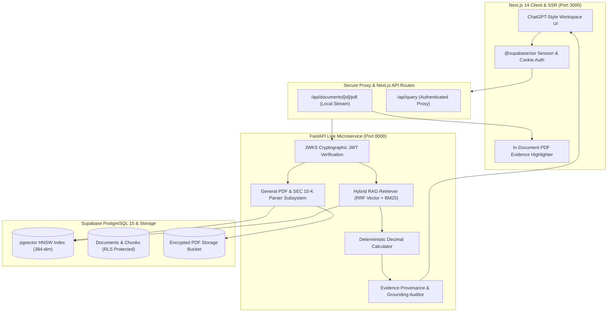

# DocIntel — Institutional Financial Document Intelligence Platform

[](https://fastapi.tiangolo.com)
[-black.svg?logo=next.js&logoColor=white)](https://nextjs.org)
[](https://supabase.com)
[](https://python.org)
[](#license)

An enterprise-grade, multi-tenant AI document intelligence and financial statement analysis system. Designed for investment analysts, auditors, and compliance teams, DocIntel pairs dense vector embeddings (`pgvector`) and BM25 lexical keyword matching with deterministic **Decimal** arithmetic and in-document chunk evidence highlighting.

---

## 🏛 Architecture Overview



---

## 🚀 Key Features

### 1. In-Document Chunk & Evidence Highlighting
- **Interactive Split View**: Compare the illuminated verbatim chunk (left) alongside the original page in the embedded PDF canvas (right).
- **Native PDF Canvas Highlighting**: Automatically extracts distinctive token phrases and injects `#page=N&search="phrase"` into browser PDF engines (Chromium, Edge, Firefox), highlighting occurrences directly on the PDF page.
- **Illuminated Marker Layer**: Numerical financial figures (`$391,035M`, `31.51%`), dates, and metrics are highlighted in glowing amber badges.
- **View Modes**: Instantly toggle between `Split View`, `Full PDF`, and `Evidence Text` reader.

### 2. Multi-Company & General Document Support
- **Curated SEC 10-K Filings**: Multi-year reports for Apple (`AAPL`), Microsoft (`MSFT`), Amazon (`AMZN`), and Meta (`META`) cataloged with table cell bounding coordinates.
- **General PDF Ingestion**: Upload contracts, financial notes, resumes, invoices, and research papers via `GeneralPDFParser` with memory-safe `pdfplumber` layout flushes and SHA-256 deduplication.
- **100% Self-Contained Provenance**: Zero external dependencies on external Edgar servers; all documents render through secure internal streaming proxies.

### 3. Audited Zero-Hallucination Guardrails
- **Deterministic Decimal Arithmetic**: Financial ratios (Operating Margins, YoY Growth, Variance) are computed using Python `decimal.Decimal` to avoid binary floating-point roundoff errors.
- **Audited Numerical Grounding**: Verifies that every number stated in the narrative answer corresponds to an exact table row or calculation operand.
- **Comparative Multi-Year Scoping**: Automatically references prior-year comparative columns within a single filing (FY24, FY23, FY22).

### 4. Enterprise Multi-Tenancy & 3-Layer Authentication
- **Layer 1 (Frontend)**: Next.js SSR session cookies managed via `@supabase/ssr`.
- **Layer 2 (Microservice Gateway)**: FastAPI Bearer token validation verifying RSA256 cryptographic signatures against official Supabase project JWKS.
- **Layer 3 (Database)**: Row-Level Security (`RLS`) policies isolating tenant documents, private embeddings, and query sessions.

### 5. OpenAI / ChatGPT System Aesthetics
- **System Typography**: Clean font stack (`-apple-system, BlinkMacSystemFont, "Segoe UI", Roboto, sans-serif`).
- **Exclusive Modal Controller**: Enforces strict single-dialog rendering (`activeModal`), preventing overlapping popups.
- **Bottom Profile Popover**: Access account details, light/dark theme toggles, user settings, and audit guidelines from a single bottom-docked user bar.

---

## 🔒 Security Architecture & Threat Defense

DocIntel adheres to strict **Defense-in-Depth** engineering standards:

| Threat Category | Potential Attack Vector | DocIntel Mitigation & Hardening |
|---|---|---|
| **Broken Access Control (OWASP #1)** | Tenant data leakage / BOLA | Supabase RLS enforces `user_id` filtering at the database layer; FastAPI JWKS verifies tenant identity on every request. |
| **SQL Injection (OWASP #3)** | Malicious SQL in search or filters | All database interactions use `psycopg` parameterized queries (`%s`). Zero raw SQL string interpolation. |
| **Malicious File Upload (OWASP #4)** | Executable masking, PDF bombs, DoS | Enforces `.pdf` extension check, **magic bytes header validation (`%PDF-`)**, 30 MB file size caps, and SHA-256 deduplication. |
| **Cross-Origin Attacks (CORS)** | Unauthorized cross-domain API scraping | FastAPI CORS restricts access exclusively to explicit origins (`http://localhost:3000`, `127.0.0.1:3000`). |
| **Clickjacking / MIME Sniffing** | Iframe embedding attacks | Next.js sets `X-Frame-Options: SAMEORIGIN`, `X-Content-Type-Options: nosniff`, and restrictive `Permissions-Policy`. |
| **Prompt Injection / Jailbreaks** | Adversarial instructions in uploaded PDFs | Deterministic evidence validator checks all LLM outputs against factual chunk tables; rejects unauthorized code or trading advice. |
| **Denial of Service (Memory Exhaustion)** | PDF parser memory leaks on large files | `GeneralPDFParser` flushes pdfminer layout cache (`page.flush_cache()`) and triggers garbage collection every 20 pages. |

---

## 📂 Project Structure

```
Financial_Document_Intelligence/
├── backend/
│   ├── app/
│   │   ├── api/v1/             # Endpoints: /query, /documents, /auth, /health
│   │   ├── core/               # Security, JWKS JWT verification, Config, Settings
│   │   ├── integrations/       # Supabase storage, HuggingFace embeddings, LLM models
│   │   ├── parsers/            # BaseParser, GeneralPDFParser, SEC10KParser, Factory
│   │   ├── schemas/            # Pydantic validation schemas (Citations, Facts, Queries)
│   │   └── services/           # AnsweringService, RetrievalService, Calculations, Evidence
│   └── tests/                  # Deterministic pytest suite (52 tests)
├── frontend/
│   ├── src/
│   │   ├── app/                # Next.js 14 App Router, globals.css, layout.jsx, page.jsx
│   │   ├── components/
│   │   │   ├── auth/           # Login / Sign-in UI, Password Strength Meter
│   │   │   ├── modals/         # Exclusive modals: PdfViewer, Upload, Compare, Profile, Settings, Guide
│   │   │   └── workspace/      # Sidebar, MessageThread, ChatInput, AnswerWorkspace, InspectorDrawer
│   │   └── lib/                # Supabase browser/server clients, mock fallback engine
│   └── next.config.mjs         # Production Next.js configuration with security headers
├── docs/                       # Technical Reference Document (TRD), Architecture, Memory
└── data/                       # Curated 10-K PDFs and table inventory
```

---

## 🛠 Local Setup & Development

### Prerequisites
- Python 3.11 or 3.12
- Node.js 18+ and npm
- PostgreSQL database with `pgvector` (or a Supabase cloud instance)

### 1. Backend Service (FastAPI)
```bash
# Activate virtual environment
.\venv\Scripts\Activate.ps1

# Start the FastAPI microservice on port 8000
cd backend
uvicorn app.main:app --reload --port 8000
```
API Documentation will be available at: [http://localhost:8000/docs](http://localhost:8000/docs)

### 2. Frontend Application (Next.js)
```bash
# In a new terminal
cd frontend

# Run development server on port 3000
npm run dev

# Or build for production
npm run build
npm start
```
Web Workspace will be available at: [http://localhost:3000](http://localhost:3000)

### 3. Running Test Suites
```bash
# Run backend deterministic test suite
pytest backend/tests/ -v
```

---

## 📄 License
Proprietary — Developed for Institutional Financial Document Intelligence.

