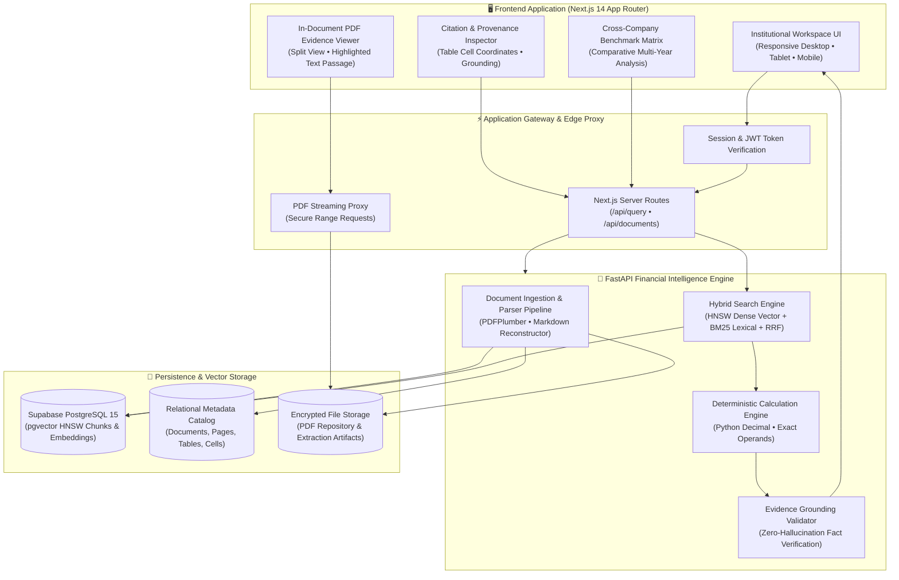

<div align="center">

# 📊 DocIntel
### Enterprise Institutional Document Intelligence & Financial Audit Platform

[](https://fastapi.tiangolo.com)
[-black.svg?style=flat-square&logo=next.js&logoColor=white)](https://nextjs.org)
[](https://supabase.com)
[](https://python.org)
[](https://docker.com)
[](LICENSE)

<p align="center">
  <b>A production-grade, multi-tenant AI document intelligence workspace designed for equity research analysts, auditors, and financial compliance teams.</b>
</p>

[Key Features](#-key-features) • [Architecture Overview](#-architecture-overview) • [Quickstart Guide](#-quickstart-guide) • [API Reference](#-api-reference) • [Tech Stack](#-tech-stack)

---

</div>

## 💡 Overview

Standard Retrieval-Augmented Generation (RAG) applications frequently fail when applied to complex financial statements, annual 10-K filings, and regulatory contracts due to **hallucinations, loss of tabular structure, and binary floating-point roundoff errors**.

**DocIntel** solves this by pairing:
1. **Hybrid Retrieval**: Dense vector embeddings (`pgvector` with HNSW indexing) combined with sparse BM25 lexical search using Reciprocal Rank Fusion (RRF).
2. **Deterministic Arithmetic**: A Python `decimal.Decimal` calculation ledger that calculates operating margins, growth rates, and variances with financial precision.
3. **In-Document Canvas Provenance**: Verbatim citation deep-linking that opens the source PDF directly to the specific page and highlights supporting disclosures.
4. **Adaptive Multi-Device UX**: An institutional ChatGPT-style interface optimized across desktop, tablet (iPad Mini, Air, Pro), foldable, and mobile devices.

---

## 🏛 Architecture Overview



### The DocIntel Pipeline

| Stage | Responsibility | Technology |
|---|---|---|
| **1. Layout-Aware Ingestion** | Extracts text and financial tables from SEC 10-Ks and general PDFs while preserving column alignment and headers. | `pdfplumber`, Memory Cache Flushes |
| **2. Chunk & Table Synthesis** | Transforms unstructured narratives and structured table rows into bounded context chunks with repeated column schemas. | GFM Markdown Tables, Custom Chunk Builder |
| **3. Hybrid Search (RRF)** | Queries dense 384-dimensional embeddings alongside BM25 sparse keyword indices, combining ranks via Reciprocal Rank Fusion. | `pgvector` HNSW Index, PostgreSQL Full-Text Search |
| **4. Grounded Calculation** | Dissects financial math (e.g., Margin = Operating Income ÷ Net Sales) into deterministic, verified decimal operations. | Python `decimal.Decimal`, AST Parsing |
| **5. Citation Provenance** | Binds every metric to its source filing, page number, and paragraph coordinates with interactive in-canvas viewing. | Browser PDF Viewer Engine, Text Search Anchors |

---

## ✨ Key Features

### 🔍 Interactive In-Document Evidence Highlighting
- **Split-View Canvas**: View the illuminated verbatim passage alongside the original filing in an embedded PDF canvas.
- **Deep-Link Anchors**: Automatically routes to the exact page index (`#page=N&search="phrase"`) to highlight supporting disclosure text.
- **Inspection Drawer**: Click any citation pill to verify source metadata, table cell IDs, and extracted verbatim excerpts.

### 📐 Zero-Hallucination Decimal Arithmetic
- **Strict Decimal Precision**: Replaces imprecise float calculations with `decimal.Decimal` to ensure balance sheet equations reconcile.
- **Audit Ledger Breakdown**: Expandable computation breakdowns show explicit formulas, intermediate steps, and cited operands.
- **Multi-Year Comparative Filings**: Automatically extracts 3-year historical figures (FY24, FY23, FY22) from a single annual report.

### 🏢 Cross-Company Benchmark Matrix
- **Side-by-Side Comparison**: Compare revenue, operating income, net margin, and segment performance across Apple, Microsoft, Amazon, and Meta.
- **Interactive Multi-Chart Views**: Switch between responsive data tables and visual benchmark graphs with touch-friendly controls.
- **Export Capabilities**: Download structured financial memorandums and grounded audit trails in Excel format.

### 📱 Responsive Across Every Device
- **Adaptive Breakpoints**: Custom UX for mobile smartphones (iOS/Android), iPads (Mini, Air, Pro), foldables, and desktop displays.
- **Drawer Navigation**: Sidebar and chunk inspector collapse into off-canvas sliding drawers with backdrop blur dismiss on screens $\le$ 1024px.
- **Mobile-Tuned Inputs**: Includes safe-area inset padding for iPhone Dynamic Islands and locks textarea typography to prevent iOS Safari auto-zoom.

---

## 📂 Project Architecture

```
Financial_Document_Intelligence/
├── backend/
│   ├── app/
│   │   ├── api/v1/              # REST Endpoints (/query, /documents, /auth, /health)
│   │   ├── core/                # Configuration, Supabase JWT Auth, Settings
│   │   ├── integrations/        # HuggingFace Embeddings, Groq/OpenAI Models, Supabase Client
│   │   ├── parsers/             # BaseParser, GeneralPDFParser, SEC10KParser, Ingestion Engine
│   │   ├── schemas/             # Pydantic Schemas (Citations, Facts, Queries, Responses)
│   │   └── services/            # AnsweringService, RetrievalService, Calculator, Evidence
│   ├── tests/                   # Deterministic Unit & Integration Test Suite (52+ tests)
│   ├── Dockerfile               # Production Multi-Stage Backend Container
│   └── requirements.txt         # Pinned Backend Dependencies
├── frontend/
│   ├── src/
│   │   ├── app/                 # Next.js 14 App Router (layout.jsx, page.jsx, globals.css)
│   │   ├── components/
│   │   │   ├── auth/            # Sign-In, Authentication, Password Strength
│   │   │   ├── modals/          # PdfViewerModal, UploadModal, CompareMatrixModal, SettingsModal
│   │   │   └── workspace/       # Sidebar, MessageThread, ChatInputDock, InspectorDrawer
│   │   ├── hooks/               # useChat, useMediaQuery, useResponsive
│   │   └── lib/                 # Supabase Browser & Server Clients, Export Utilities
│   ├── Dockerfile               # Production Next.js Standalone Container
│   └── package.json             # Frontend NPM Dependencies
├── supabase/
│   └── migrations/              # PostgreSQL Schema, pgvector HNSW Indices & RLS Policies
├── docker-compose.yml           # Unified Multi-Service Container Orchestration
└── README.md                    # Platform Documentation
```

---

## 🚀 Quickstart Guide

### Prerequisites
- **Node.js**: v18.17+ or v20+
- **Python**: v3.11 or v3.12
- **Docker & Docker Compose** *(optional for containerized deployment)*
- **Supabase Account**: With PostgreSQL 15 & `pgvector` enabled

---

### Option A: Docker Compose (Production-Ready)

Launch the complete full-stack environment with a single command:

```bash
# 1. Clone repository
git clone https://github.com/Prabhu-Jethi/Financial_Document_Intelligence.git
cd Financial_Document_Intelligence

# 2. Configure environment variables
cp .env.example .env
# Edit .env with your Supabase, HuggingFace, and Groq/OpenAI credentials

# 3. Spin up all containerized services
docker compose up --build -d

# 4. Verify running health status
docker compose ps
```

- **Web Application**: [http://localhost:3000](http://localhost:3000)
- **API Documentation (Swagger UI)**: [http://localhost:8000/docs](http://localhost:8000/docs)
- **Health Endpoint**: [http://localhost:8000/health/live](http://localhost:8000/health/live)

---

### Option B: Local Bare-Metal Setup

#### 1. Backend Service (FastAPI)

```bash
# Navigate to backend directory
cd backend

# Create and activate virtual environment
python -m venv venv
# Windows:
.\venv\Scripts\Activate.ps1
# Linux/macOS:
source venv/bin/activate

# Install dependencies
pip install -r requirements.txt

# Run database migrations (or execute in Supabase SQL editor)
# See: supabase/migrations/20261004000000_initial_schema.sql

# Start development server
uvicorn app.main:app --reload --port 8000
```

#### 2. Frontend Application (Next.js 14)

```bash
# Navigate to frontend directory in a separate terminal
cd frontend

# Install package dependencies
npm install

# Start development server
npm run dev
```

Open [http://localhost:3000](http://localhost:3000) in your browser.

---

## 🧪 Testing

DocIntel enforces strict verification through deterministic unit and integration test suites:

```bash
# Run backend test suite
pytest backend/tests/ -v

# Run targeted contract & retrieval tests
pytest backend/tests/unit/test_access.py backend/tests/unit/test_retrieval.py -v
```

---

## 📡 API Reference

| Method | Endpoint | Description | Auth Required |
|---|---|---|---|
| `POST` | `/api/v1/query` | Executes hybrid retrieval, arithmetic resolution, and citation synthesis. | Yes (Bearer JWT) |
| `POST` | `/api/v1/documents/upload` | Ingests, parses, chunks, and indexes a PDF document into pgvector. | Yes (Bearer JWT) |
| `GET` | `/api/v1/documents` | Lists cataloged and uploaded documents available to the active tenant. | Yes (Bearer JWT) |
| `GET` | `/api/v1/documents/{id}/chunks` | Retrieves all indexed chunks and table structures for a document. | Yes (Bearer JWT) |
| `GET` | `/health/live` | Liveness probe returning operational status and model readiness. | No |

---

## 🛠 Tech Stack

| Layer | Technologies |
|---|---|
| **Frontend** | Next.js 14 (App Router), React 18, CSS Custom Properties, KaTeX Math |
| **Backend** | FastAPI, Pydantic v2, Uvicorn, LangChain |
| **Database & Search** | Supabase PostgreSQL 15, `pgvector` (HNSW indexing), BM25 Full-Text Search |
| **Embeddings & LLMs** | `sentence-transformers/all-MiniLM-L6-v2`, Hugging Face Endpoints, Groq / OpenAI |
| **Document Parsing** | `pdfplumber`, `pypdf`, Markdown Layout Reconstruction |
| **DevOps & Containers** | Docker, Docker Compose, Multi-Stage Builds |

---

## 📄 License

This project is licensed under the [Apache License 2.0](LICENSE).
