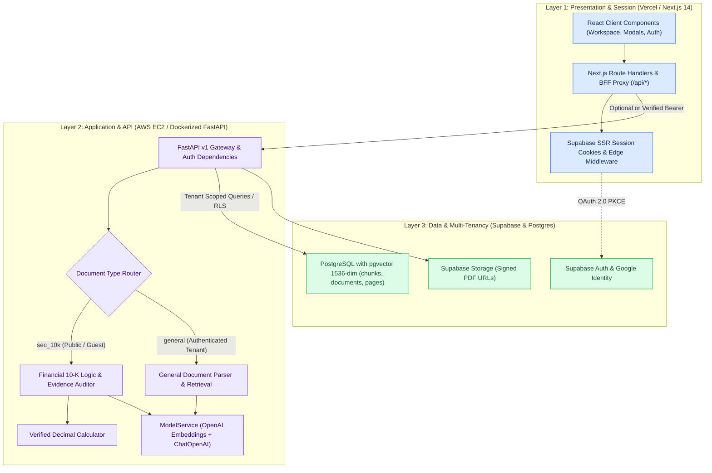
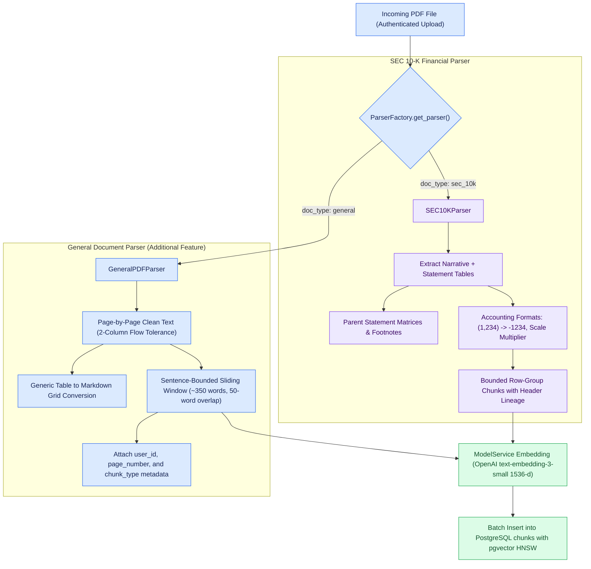
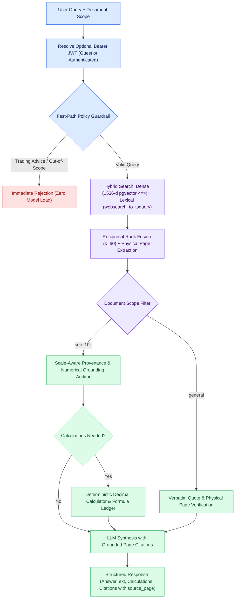
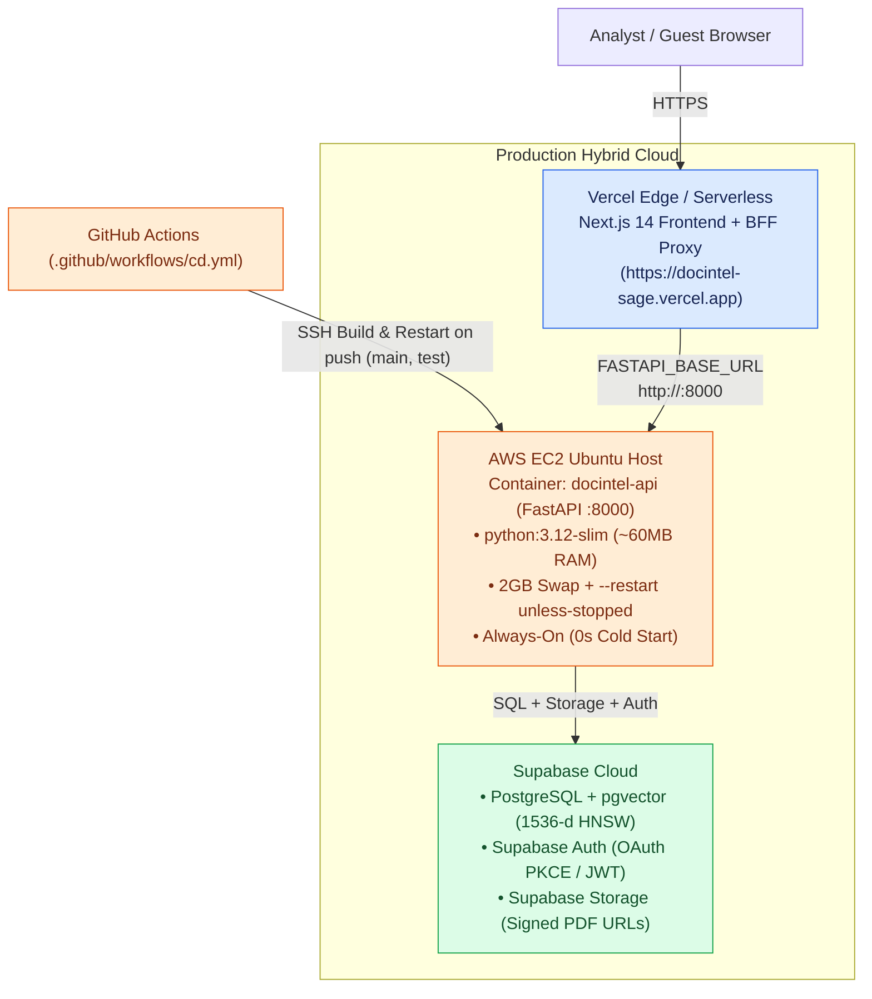
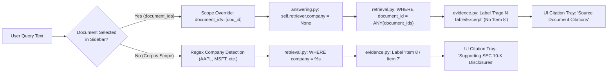

# 🟪 Architecture.md — How the pieces connect

**Financial Report Analysis Assistant & Document Intelligence Platform** · v1.10 · 25 November 2026

> 🟩 **Production hybrid cloud architecture operational.** Next.js 14 modular frontend workspace deployed on Vercel (`https://docintel-sage.vercel.app`), Dockerized FastAPI microservice (`python:3.12-slim`, ~60MB RAM, zero PyTorch) hosted on AWS EC2 with automated GitHub Actions CD (`.github/workflows/cd.yml`), Supabase PostgreSQL with 1536-dim OpenAI `text-embedding-3-small` `pgvector` HNSW indexing (`idx_chunks_embedding_hnsw`) + lexical RRF ($k=60$, $top\_k=10$), Guest Explorer Mode + authenticated multi-tenant isolation (`user_id = auth.uid()`), calibrated physical-to-printed PDF page alignment (`DEC-070`), and a 60-case deterministic unit test suite verified offline in CI.

[Requirements](Trd.md) · [Architecture](Architecture.md) · [Rules](rules.md) · [Phases](phases.md) · [Memory](memory.md)

---

## 1. Application map & 3-layer security



| Layer | Responsibility | Security Boundary |
|---|---|---|
| **Next.js 14 (Vercel)** | Workspace UI, zero-flash theme persistence (`layout.jsx`), SSR session cookies, `/api/*` BFF proxy, local SEC corpus fallback | Same-origin browser requests, edge middleware session refresh, no browser-exposed service role keys. |
| **FastAPI (AWS EC2)** | Optional/mandatory JWT verification (`get_optional_user` / `get_current_user`), multi-tenant upload barrier (HTTP 401 for guests on `/upload`), Decimal math, hybrid RAG | Rejects unauthenticated uploads (`POST /api/v1/documents/upload`) and private metadata calls with HTTP 401; derives `user_id` strictly from verified JWT `sub` claim. |
| **Supabase / Postgres** | Auth management, 1536-dim `pgvector` HNSW search, private PDF bucket, Row Level Security (RLS) | Curated SEC 10-K filings remain publicly explorable in Guest Mode; `user_query_history` and user-uploaded documents (`user_id IS NOT NULL`) are isolated per `user_id = auth.uid()`. |

---

## 2. Pluggable Document Parsing Subsystem

The ingestion engine is structured as a **Pluggable Parser Architecture** (`backend/app/parsers/`), maintaining strict financial 10-K extraction while enabling authenticated general PDF parsing as a dedicated feature:



### SEC 10-K Parser vs. General PDF Parser

| Dimension | SEC 10-K Financial Parser | General PDF Parser (Additional Feature) |
|---|---|---|
| **Target Corpus** | Annual SEC Form 10-K filings (Item 7 MD&A, Item 8 Financials) | Arbitrary user-uploaded PDFs (contracts, research notes, invoices, whitepapers) |
| **Table Handling** | Strict cell matrices, period header paths, accounting parentheses `(1,234)`, scale multipliers ($M) | Generic tables converted to Markdown grids (`\| Col 1 \| Col 2 \|`) preserving column alignments |
| **Narrative Chunking** | Bounded sections mapped to corporate filing disclosure items | Sliding word window (~350 words, 50-word overlap) preserving 2-column reading order (`use_text_flow=True`) |
| **Data Tenancy** | Curated system-wide corpus accessible in Guest Explorer Mode & Authenticated sessions | Multi-tenant isolation: tagged with `user_id`, empty for guests/new users, protected via RLS |
| **Citation Output** | Company, fiscal year, statement section, printed footer page + calibrated 1-based physical `source_page`, verbatim quote | Document filename, physical page index (`source_page`), verbatim excerpt quote |

---

## 3. Query Execution, Physical Page Resolution & Grounding



* **Grounding Guarantee:** No numeric claim is presented as verified unless matched against an indexed chunk or derived via `FinancialCalculator`.
* **Physical-to-Printed Page Alignment (`DEC-070`):** Both `retrieval.py` and `evidence.py` extract the 1-based physical sheet index (`physical_page` / `source_page`) strictly from `P(\d+)` page identifiers using negative lookahead `(?![a-zA-Z])` so `-10K` document prefixes never corrupt pagination. `PdfViewerModal.jsx` renders dual transparency badges (`PAGE {currentPage} (Report P. {printed_page})`) when physical sheet index differs from printed report numbering.

---

## 4. Current Repository Structure

```plaintext
Financial_Doc/
├── .github/workflows/
│   ├── ci.yml                              # Offline backend unit tests (60 cases), Next.js build, Docker validation
│   └── cd.yml                              # Automated SSH Docker deployment to AWS EC2 (main & test branches)
├── docker-compose.yml                      # Unified local multi-container orchestration & bridge networking
├── .env.example                            # Full-stack environment template
│
├── backend/
│   ├── Dockerfile                          # Lightweight python:3.12-slim (~60MB runtime, zero PyTorch, curl healthcheck)
│   ├── .dockerignore                       # Excludes venv, tests, and caches
│   ├── requirements.txt                    # Pruned API-driven production dependencies
│   ├── app/
│   │   ├── main.py                         # FastAPI app, CORS middleware, root & /health/* probes
│   │   ├── schemas.py                      # Typed Pydantic v2 API contracts
│   │   ├── api/v1/
│   │   │   ├── router.py                   # API v1 router aggregation
│   │   │   ├── auth.py                     # Authenticated profile inspection (/auth/me)
│   │   │   ├── document.py                 # Guest-aware catalog, async PDF upload, status polling, signed URLs
│   │   │   ├── health.py                   # Liveness & PostgreSQL readiness endpoints
│   │   │   └── query.py                    # Audited RAG query execution + fast-path guardrail
│   │   ├── core/                           # System settings & JWT validation
│   │   │   ├── config.py                   # Pydantic BaseSettings
│   │   │   └── security.py                 # Supabase JWT verification (get_current_user, get_optional_user)
│   │   ├── parsers/                        # Pluggable parser subsystem
│   │   │   ├── base.py                     # BaseParser interface
│   │   │   ├── factory.py                  # ParserFactory resolver
│   │   │   ├── sec_10k_parser.py           # Financial statement & accounting parser
│   │   │   └── gen_pdf_parser.py           # Generic 2-column PDF & markdown table parser
│   │   ├── services/                       # Business logic services
│   │   │   ├── ingestion.py                # Pipeline orchestration
│   │   │   ├── retrieval.py                # Dense + Lexical RRF search & physical page attribution
│   │   │   ├── calculations.py             # Decimal arithmetic solver
│   │   │   ├── evidence.py                 # Provenance, source_page resolution & grounding auditor
│   │   │   └── answering.py                # LLM cited response generator & comparative routing
│   │   └── integrations/                   # Infrastructure adapters
│   │       ├── database.py                 # pgvector client
│   │       ├── storage.py                  # Supabase Storage client
│   │       └── models.py                   # OpenAI text-embedding-3-small & ChatOpenAI adapter
│   └── tests/unit/                         # 60 deterministic offline unit tests
│
├── frontend/
│   ├── Dockerfile                          # Multi-stage production build (Node 20 Alpine)
│   ├── .dockerignore                       # Excludes node_modules, .next, and envs
│   ├── package.json                        # Next.js 14, React 18, Supabase SSR
│   ├── src/
│   │   ├── app/                            # App Router routes & layouts
│   │   │   ├── globals.css                 # Theme tokens, modal styles & WCAG AA/AAA styling
│   │   │   ├── layout.jsx                  # Root layout with synchronous anti-flash theme script
│   │   │   ├── page.jsx                    # Primary analysis workspace (guest + authenticated)
│   │   │   ├── login/page.jsx              # Interactive Google OAuth & classic auth
│   │   │   ├── workspace/page.jsx          # Protected workspace route
│   │   │   ├── auth/callback/route.js      # PKCE exchange route
│   │   │   └── api/                        # Next.js BFF proxy routes (documents, query, health, history, upload)
│   │   ├── components/
│   │   │   ├── Header.jsx                  # Top navigation, live engine status & theme/profile controls
│   │   │   ├── auth/                       # PasswordStrengthMeter, RoleChipSelector
│   │   │   ├── workspace/                  # Sidebar, SidebarPanel, ChatInput, MessageThread, AnswerWorkspace, FinancialChart, InspectorDrawer, KpiStrip, QueryConsole
│   │   │   └── modals/                     # PdfViewerModal, UploadModal, CompareMatrixModal, ProfileModal, SettingsModal, AuditGuideModal
│   │   ├── hooks/                          # useAuth, useChat, useTheme
│   │   └── lib/                            # constants.js, exportExcel.js, server/api.js, server/mockEngine.js, supabase/
│   └── middleware.js                       # Next.js edge session middleware
│
├── supabase/
│   └── migrations/                         # Versioned SQL migrations (RLS, 1536-dim HNSW vector index, schema)
├── data/                                   # Document lake (11 original SEC 10-Ks, manifest)
└── evaluation/                             # Quantitative benchmark suites & results
```

---

## 5. Technology Stack Summary

| Component | Technology | Role |
|---|---|---|
| **Frontend & BFF** | Next.js 14 (App Router, React 18 SSR) on **Vercel** | Client workspace UI, SSR session cookies, zero-flash theme restoration, server proxy to EC2 |
| **Styling** | Vanilla CSS with Custom Properties | Strict WCAG AA/AAA compliance, 5-tier responsive layouts, zero bundle bloat |
| **Backend API** | Python 3.12, FastAPI, Pydantic v2 in **Docker on AWS EC2** | High-performance async microservice (~60MB RAM), typed contracts, always-on compute |
| **CI/CD** | GitHub Actions (`ci.yml` + `cd.yml`) | 60-test offline CI gate + automated SSH Docker rebuild/restart on AWS EC2 |
| **Database & Vectors** | Supabase PostgreSQL + `pgvector` HNSW | Relational tables, full-text lexical search, 1536-dim cosine similarity index |
| **Authentication** | Supabase Auth (Google OAuth 2.0 PKCE + Email/Pass) | Guest exploration mode for SEC 10-Ks + isolated multi-tenant uploads (`user_id = auth.uid()`) |
| **PDF Extraction** | `pdfplumber` | Coordinate text extraction, 2-column flow reconstruction, table matrices |
| **Embeddings** | OpenAI `text-embedding-3-small` (API) | 1536-dimensional normalized dense vectors (eliminates local PyTorch bloat) |
| **Generative LLM** | `ChatOpenAI` adapter (`gpt-6-luna`) | Grounded answering, citation synthesis, operand identification |

---

## 6. Production Hybrid Deployment Topology

In production, DocIntel decouples the presentation proxy from compute-heavy backend orchestration:



### Key Deployment & Container Optimizations:
1. **Zero-PyTorch Container Footprint**: Replacing local `sentence-transformers`/PyTorch with API-driven OpenAI `text-embedding-3-small` reduced the backend memory footprint from ~450MB down to ~60MB RAM and dropped startup time from ~25s to < 1.5s.
2. **Always-On AWS EC2 + Automated CD**: Eliminates PaaS free-tier sleep cold-starts and monthly running-hour exhaustion; `.github/workflows/cd.yml` pulls changes, rebuilds `docintel-backend:latest`, and restarts `docintel-api` automatically on pushes to `main` and `test`.
3. **Resilient BFF Fallback**: If the upstream FastAPI service is temporarily unreachable or restarting, Next.js `api.js` serves verified curated SEC 10-K resolutions (`mockEngine.js`) for general queries while clearly guarding document-specific queries.

---

## 7. Target System Design Blueprint for 1,000 Users

| Pillar | Architecture Pattern | Implementation Details |
|---|---|---|
| **1. Asynchronous Ingestion** | Background Worker (ARQ / Celery + Redis) | Upload endpoint currently returns `HTTP 202 Accepted` with FastAPI `BackgroundTasks`; scales cleanly to durable Redis workers at 1,000 users. |
| **2. Connection Pooling & Indexing** | Supavisor / PgBouncer + HNSW | Routes transactions through Supabase connection pooler (port 6543) with existing `idx_chunks_embedding_hnsw` for sub-50ms vector lookups. |
| **3. Multi-Tenant Isolation** | PostgreSQL Row-Level Security (RLS) | `documents` and `chunks` isolate private uploads to `user_id = auth.uid()` while allowing guest read access to curated SEC 10-K filings. |
| **4. Cost & Quota Defense** | SlowAPI Rate Limiting + Two-Tier Cache | Planned L1 RAM LRU + L2 Redis cache for deterministic SEC 10-K queries to eliminate repeat embedding/LLM API costs and cut latency under 10ms. |
| **5. Auditable Observability** | Structured Logging with `request_id` | Propagates `X-Request-ID` across Next.js and FastAPI responses with latency breakdowns (`timings_ms`). |

---

## 8. Strict Document Scoping & Contamination Elimination

To guarantee that queries on user-uploaded documents (e.g., general contracts, invoices, research papers) are never contaminated by SEC 10-K company disclosures:



---

## 9. Universal Multi-Device Responsive Architecture

DocIntel implements a 5-tier responsive layout supporting desktops, tablets (iPad Mini, Air, Pro in landscape & portrait), foldables, and mobile phones:

| Viewport Tier | Key Responsive Behaviors |
|---|---|
| **Desktop (> 1024px)** | Fixed 3-column institutional layout: Sidebar (260px) + Main Conversation Feed + Provenance Inspector (350px). |
| **Tablet (<= 1024px)** | Off-canvas drawer layout: Sidebar and Inspector slide over the stage with `backdrop-filter: blur(3px)` touch-dismiss. Prevents squeezing chat area. |
| **Standard Tablet (<= 768px)** | Sticky first-column locking on `.compare-benchmark-table` for horizontal swipe navigation. Horizontal scrollable tab strip on Settings modal. |
| **Mobile (<= 640px)** | `font-size: 16px !important` on `.chatgpt-textarea` to prevent iOS Safari auto-zoom. Full safe-area inset support (`env(safe-area-inset-bottom/top)`) for iPhone Dynamic Island and home indicators. 36px touch targets for action buttons. |
| **Compact (<= 400px)** | Compact top bar with auto-collapsed scope badges to prevent horizontal page blowout. |
