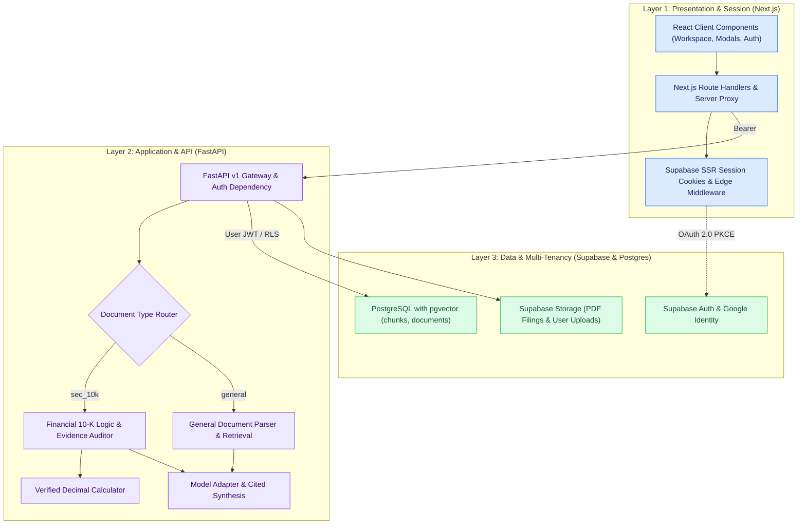
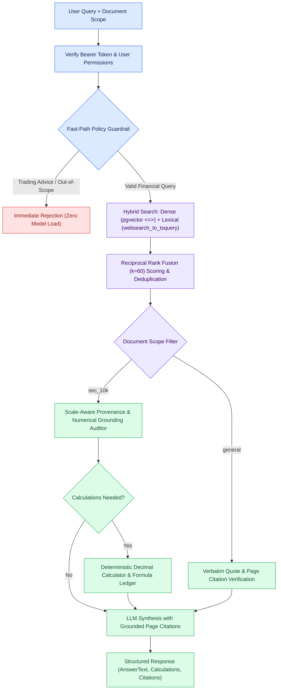
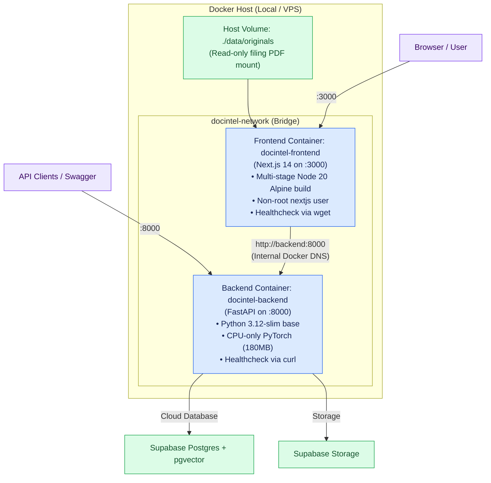
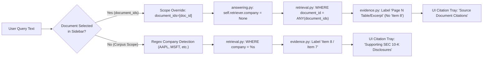

# 🟪 Architecture.md — How the pieces connect

**Financial Report Analysis Assistant & Document Intelligence Platform** · v1.7 · 5 November 2026

> 🟩 **Application implementation in progress.** Full-stack integration active: Next.js 14 modular frontend workspace, 3-layer microservice authentication (Next.js SSR cookies + FastAPI Bearer token verification + Supabase Row Level Security), dedicated hybrid retrieval service (`retrieval.py` with Dense + Lexical RRF $k=60$, $top\_k=10$), evidence validation & scale-aware provenance auditor (`evidence.py`), and pluggable parser subsystem architecture. Fast-path out-of-scope query guardrail eliminates cold model loading. Dev benchmark baseline verified at 100% (20/20) with 52 deterministic unit tests passing in offline CI. Strict document scoping eliminates cross-document SEC contamination on uploaded PDFs. HNSW vector indexing (`idx_chunks_embedding_hnsw`) accelerates similarity search. Multi-device responsive architecture guarantees seamless mobile, tablet, and desktop UX.

[Requirements](Trd.md) · [Architecture](Architecture.md) · [Rules](rules.md) · [Phases](phases.md) · [Memory](memory.md)

---

## 1. Application map & 3-layer security



| Layer | Responsibility | Security Boundary |
|---|---|---|
| **Next.js 14** | Workspace UI, interactive modals, session cookies, route protection (`/workspace`) | Same-origin requests, edge middleware session refresh, no browser-exposed service keys. |
| **FastAPI** | Token verification, access enforcement, financial calculations, RAG retrieval | Rejects unauthenticated calls with HTTP 401; derives identity strictly from verified `sub` claim. |
| **Supabase / Postgres** | Auth management, pgvector similarity search, Row Level Security (RLS) | `user_query_history` and private documents isolated by `user_id = auth.uid()`. Curated filings remain shared. |

---

## 2. Pluggable Document Parsing Subsystem

The ingestion engine is structured as a **Pluggable Parser Architecture** (`backend/app/parsers/`), maintaining strict financial 10-K extraction while enabling general PDF parsing as a dedicated feature:

```mermaid
flowchart TD
    UPLOAD["Incoming PDF File"] --> FACTORY{"ParserFactory.get_parser()"}
    
    subgraph SEC_PARSER["SEC 10-K Financial Parser"]
        FACTORY -->|"doc_type: sec_10k"| P_SEC["SEC10KParser"]
        P_SEC --> EX_SEC["Extract Narrative + Statement Tables"]
        EX_SEC --> PARENT["Parent Statement Matrices & Footnotes"]
        EX_SEC --> ACC["Accounting Formats: (1,234) -> -1234, Scale Multiplier"]
        ACC --> CHK_SEC["Bounded Row-Group Chunks with Header Lineage"]
    end

    subgraph GEN_PARSER["General Document Parser (Additional Feature)"]
        FACTORY -->|"doc_type: general"| P_GEN["GeneralPDFParser"]
        P_GEN --> EX_GEN["Page-by-Page Clean Text Extraction"]
        EX_GEN --> TBL_MD["Generic Table to Markdown Grid Conversion"]
        EX_GEN --> CHK_GEN["Sentence-Bounded Sliding Window (~350 words, 50-word overlap)"]
        CHK_GEN --> META_GEN["Attach user_id, page_number, and chunk_type metadata"]
    end

    CHK_SEC --> EMBED["ModelService Embedding (MiniLM 384-d)"]
    CHK_GEN --> EMBED
    EMBED --> STORE["Batch Insert into PostgreSQL chunks with pgvector"]

    classDef blue fill:#DBEAFE,stroke:#2563EB,color:#172554
    classDef purple fill:#EDE9FE,stroke:#7C3AED,color:#3B0764
    classDef green fill:#DCFCE7,stroke:#16A34A,color:#14532D
    class UPLOAD,FACTORY blue
    P_SEC,EX_SEC,PARENT,ACC,CHK_SEC purple
    P_GEN,EX_GEN,TBL_MD,CHK_GEN,META_GEN blue
    EMBED,STORE green
```

### SEC 10-K Parser vs. General PDF Parser

| Dimension | SEC 10-K Financial Parser | General PDF Parser (Additional Feature) |
|---|---|---|
| **Target Corpus** | Annual SEC Form 10-K filings (Item 7 MD&A, Item 8 Financials) | Arbitrary user-uploaded PDFs (contracts, research notes, invoices, whitepapers) |
| **Table Handling** | Strict cell matrices, period header paths, accounting parentheses `(1,234)`, scale multipliers ($M) | Generic tables converted to Markdown grids (`\| Col 1 \| Col 2 \|`) preserving column alignments |
| **Narrative Chunking** | Bounded sections mapped to corporate filing disclosure items | Sliding word window (~350 words, 50-word overlap) preserving bullet points and formulas |
| **Data Tenancy** | Curated system-wide corpus shared across authenticated users | Multi-tenant isolation: tagged with `user_id`, protected via Supabase RLS |
| **Citation Output** | Report fiscal year, statement name, printed page, verbatim quote | Document title/filename, physical page index, verbatim excerpt quote |

---

## 3. Query Execution & Evidence Grounding



* **Grounding Guarantee:** No numeric claim is presented as verified unless matched against an indexed chunk.
* **Citation Tracking:** Every returned citation carries exact `printed_page`, `exact_quote`, and `section` so users can inspect the original PDF page in `PdfViewerModal.jsx`.

---

## 4. Current & Target Folder Map

```plaintext
Financial_Document_Intelligence/
├── docker-compose.yml                      # Unified multi-container orchestration & networking
├── .env.example                            # Full-stack environment template
│
├── backend/
│   ├── Dockerfile                          # Python 3.12-slim, CPU PyTorch layer, curl healthcheck
│   ├── .dockerignore                       # Excludes venv, tests, and caches
│   ├── requirements.txt                    # 15 core production dependencies
│   ├── app/
│   │   ├── api/
│   │   │   ├── dependencies.py             # Auth dependencies (get_current_user)
│   │   │   ├── document.py                 # Filing & upload routes
│   │   │   └── query.py                    # RAG query execution
│   │   ├── core/                           # System settings & JWT validation
│   │   │   ├── config.py                   # Pydantic BaseSettings
│   │   │   └── security.py                 # Supabase token parsing & JWKS
│   │   ├── parsers/                        # Pluggable parser subsystem
│   │   │   ├── base.py                     # BaseParser interface
│   │   │   ├── factory.py                  # ParserFactory resolver
│   │   │   ├── sec_10k_parser.py           # Financial statement & accounting parser
│   │   │   └── general_pdf_parser.py       # Generic PDF & markdown table parser
│   │   ├── services/                       # Business logic services
│   │   │   ├── ingestion.py                # Pipeline orchestration
│   │   │   ├── retrieval.py                # Dense + Lexical RRF search
│   │   │   ├── calculations.py             # Decimal arithmetic solver
│   │   │   ├── evidence.py                 # Provenance & citation auditor
│   │   │   └── answering.py                # LLM cited response generator
│   │   └── integrations/                   # Infrastructure adapters
│   │       ├── database.py                 # pgvector client
│   │       ├── storage.py                  # Supabase Storage client
│   │       └── models.py                   # HuggingFace & ChatOpenAI
│   └── tests/                              # 52 deterministic unit tests
│
├── frontend/
│   ├── Dockerfile                          # Multi-stage production build (Node 20 Alpine)
│   ├── .dockerignore                       # Excludes node_modules, .next, and envs
│   ├── package.json                        # Next.js 14, React 18, Supabase SSR
│   ├── src/
│   │   ├── app/                            # App Router routes & layouts
│   │   │   ├── globals.css                 # Theme tokens & WCAG AA/AAA styling
│   │   │   ├── layout.jsx                  # Root layout
│   │   │   ├── page.jsx                    # Primary analysis workspace
│   │   │   ├── login/page.jsx              # Interactive Google OAuth & classic auth
│   │   │   ├── workspace/page.jsx          # Protected workspace route
│   │   │   ├── auth/callback/route.js      # PKCE exchange route
│   │   │   └── api/                        # Next.js BFF proxy routes (documents, query, health, upload)
│   │   ├── components/
│   │   │   ├── auth/                       # PasswordStrengthMeter, RoleChipSelector
│   │   │   ├── workspace/                  # Sidebar, ChatInput, MessageThread, InspectorDrawer
│   │   │   └── modals/                     # PdfViewerModal, UploadModal, CompareMatrixModal
│   │   ├── hooks/                          # useAuth, useChat, useTheme
│   │   └── lib/                            # constants.js, exportExcel.js, supabase/
│   └── middleware.js                       # Next.js edge auth guard
│
├── supabase/
│   └── migrations/                         # Versioned SQL migrations (RLS, schema, pgvector)
├── data/                                   # Document lake (originals, parsed, manifest)
└── evaluation/                             # Quantitative benchmark suites & references
```

---

## 5. Technology Stack Summary

| Component | Technology | Role |
|---|---|---|
| **Frontend Framework** | Next.js 14 (App Router, React 18 SSR) | Client terminal UI, server cookie handling, edge route guards |
| **Styling** | Vanilla CSS with Custom Properties | Strict WCAG AA/AAA compliance, responsive layouts, zero bundle bloat |
| **Backend API** | Python 3.12, FastAPI, Pydantic v2 | High-performance async microservice, typed API contracts |
| **Database & Vectors** | PostgreSQL 15+ with `pgvector` | Relational tables, full-text lexical search, cosine distance index |
| **Authentication** | Supabase Auth (Google OAuth 2.0 PKCE + Email/Pass) | User management, session cookies, Row Level Security policies |
| **PDF Extraction** | `pdfplumber` | Precise coordinate text extraction, character bounding boxes, table grids |
| **Embeddings** | `sentence-transformers/all-MiniLM-L6-v2` | 384-dimensional normalized dense vectors |
| **Generative LLM** | `ChatOpenAI` adapter (`gpt-6-luna`) | Grounded answering, citation synthesis, operand identification |


---

## 6. Production Containerization Architecture

The entire platform is containerized using Docker and orchestrated via Docker Compose:



### Key Container Optimizations:
1. **PyTorch CPU-Only Optimization**: Pre-installs lightweight CPU-only PyTorch (`--index-url https://download.pytorch.org/whl/cpu`), dropping image wheel download size from 2,800MB to 180MB.
2. **Dependency Pruning**: Pruned `backend/requirements.txt` from 130 bloated frozen packages down to 15 core production libraries, avoiding `/tmp` disk exhaustion in constrained environments.
3. **Multi-Stage Frontend Build**: 3-stage build (`deps` $
ightarrow$ `builder` $
ightarrow$ `runner`) on Alpine Linux with unprivileged system user (`nextjs:nodejs`).
4. **Inter-Service Networking**: Uses private bridge network `docintel-network`. Frontend communicates with backend via Docker DNS `http://backend:8000`.

---

## 7. Target System Design Blueprint for 1,000 Users

| Pillar | Architecture Pattern | Implementation Details |
|---|---|---|
| **1. Asynchronous Ingestion** | Background Worker (ARQ / Celery + Redis) | Upload endpoint returns `HTTP 202 Accepted` in < 200ms with `job_id`. Long-running `pdfplumber` parsing & embedding runs asynchronously without starving web workers. |
| **2. Connection Pooling & Indexing** | Supavisor / PgBouncer + HNSW | Routes transactions through connection pool (`pool_size=20, max_overflow=10`). Adds HNSW index on `chunks.embedding` for sub-50ms vector lookups across > 100k chunks. |
| **3. Multi-Tenant Isolation** | PostgreSQL Row-Level Security (RLS) | `chunks` table enforces `metadata->>'user_id' = auth.uid()::text` for uploaded docs while allowing shared access to curated SEC 10-K filings. |
| **4. Cost & Quota Defense** | SlowAPI Rate Limiting + Redis Cache | Enforces 30 queries/min and 10 uploads/hr. Caches deterministic answers for static historical SEC 10-K filings, reducing LLM token costs by 30-45%. |
| **5. Auditable Observability** | Structured Logging with `request_id` | Propagates `request_id` across Next.js, FastAPI, and Postgres logs, tracking user ID, token usage, retrieved chunk IDs, and latency breakdown. |


---

## 8. Strict Document Scoping & Contamination Elimination

To guarantee that queries on user-uploaded documents (e.g. general contracts, invoices, research papers) are never contaminated by SEC 10-K company disclosures:



---

## 9. Universal Multi-Device Responsive Architecture

DocIntel implements a 5-tier responsive layout supporting desktops, tablets (iPad Mini, Air, Pro in landscape & portrait), foldables, and mobile phones:

| Viewport Tier | Key Responsive Behaviors |
|---|---|
| **Desktop (> 1024px)** | Fixed 3-column institutional layout: Sidebar (260px) + Main Conversation Feed + Provenance Inspector (350px). |
| **Tablet (<= 1024px)** | Off-canvas drawer layout: Sidebar and Inspector slide over the stage with `backdrop-filter: blur(3px)` touch-dismiss. Prevents squeezing chat area. |
| **Standard Tablet (<= 768px)** | Sticky first-column locking on `.compare-benchmark-table` for horizontal swipe navigation. Horizontal scrollable tab strip on Settings modal. |
| **Mobile (<= 640px)** | `font-size: 16px !important` on `.chatgpt-textarea` to prevent iOS Safari auto-zoom. Full safe-area inset support (`env(safe-area-inset-bottom/top)`) for iPhone Dynamic Island and home indicators. 36px touch targets for action buttons. |
| **Compact (<= 400px)** | Compact top bar with auto-collapsed scope badges to prevent horizontal page blowout. |
