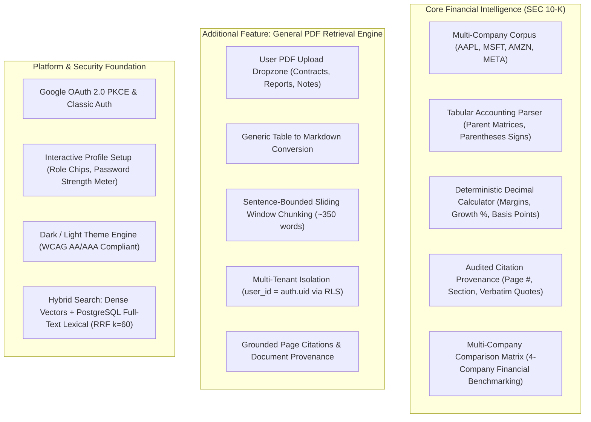

# 🟦 Trd.md — What the product must do

**Financial Report Analysis Assistant & Document Intelligence Platform** · v1.7 · 5 November 2026

> 🟩 **Application implementation complete across core & advanced tiers.** Multi-company SEC 10-K extraction (AAPL, MSFT, AMZN, META), 3-layer microservice authentication (Next.js SSR + FastAPI JWKS + Supabase RLS), interactive user profile setup, dedicated hybrid retrieval (Dense + Lexical RRF $k=60$, $top\_k=10$), deterministic Decimal calculation engine, 20-case benchmark baseline (100% pass, 100% zero-hallucination rate), and 52-case unit test suite are fully operational. Pluggable parser subsystem supports general PDF document parsing with strict single-document scoping isolation, eliminating cross-document SEC contamination. Features native in-document evidence highlighting, zero-flicker state persistence, and universal multi-device responsive design across iOS, Android, and tablets.

[Requirements](Trd.md) · [Architecture](Architecture.md) · [Rules](rules.md) · [Phases](phases.md) · [Memory](memory.md)

---

## 1. Product in one minute

| Question | Answer |
|---|---|
| **What are we building?** | An audited financial intelligence platform with cited answers, verified arithmetic ledgers, and an **additional general document parser** for arbitrary PDF retrieval. |
| **Who uses it?** | Equity research analysts, investment bankers, auditors, and enterprise professionals reviewing SEC filings and internal business documents. |
| **Primary Corpus** | Official SEC Form 10-K annual reports for Apple Inc., Microsoft Corporation, Amazon.com, Inc., and Meta Platforms, Inc. (FY2022–FY2025). |
| **Additional Feature** | **General PDF Document Parser & Retrieval Engine**: Allows authenticated users to upload arbitrary PDFs (contracts, research notes, invoices, policies), generate semantic chunks, and query them with grounded page citations. |
| **Main Risk** | Hallucinated figures, mismatched fiscal periods, wrong table units, or unverified arithmetic producing incorrect financial insights. |
| **Authentication** | 3-Layer security: Next.js SSR session cookies, Google OAuth 2.0 PKCE / classic email-password, FastAPI Bearer verification, and Supabase Row Level Security. |

---

## 2. Feature Matrix

---

## 3. Evidence Contract

Every retrieved piece of information must adhere to strict provenance requirements:

### A. SEC 10-K Financial Evidence
* **Document**: Company name, ticker, report type (`10-K`), fiscal year, period ended, verified filing date, SHA-256 hash.
* **Table Cell**: Cell coordinate, row/col headers, raw value string, normalized Decimal, period label, unit ($M), footnote text.
* **Calculation**: Derived metric name, formula, exact operands, source pages, raw Decimal result, display rounding.

### B. General Document Evidence (Additional Feature)
* **Document**: Title, uploaded file name, `user_id` (owner), `doc_type = 'general'`, total page count, upload timestamp.
* **Chunk**: Bounded narrative text or markdown table row group, physical page number (`page_1`, `page_2`), chunk ID, vector embedding.
* **Citation**: Verbatim excerpt quote, document title, physical page number, verified similarity score.
* **Isolation Rule**: General documents belong strictly to the uploading user; cross-user retrieval is blocked at the database level via Supabase RLS.

---

## 4. Supported Financial Calculations (Core Engine)

| Metric | Formula | Example Result |
|---|---|---|
| **YoY Revenue Growth %** | `(current − prior) / prior × 100` | `+2.02%` |
| **Operating Margin %** | `operating income / net sales × 100` | `31.51%` |
| **Gross Margin %** | `gross profit / net sales × 100` | `46.21%` |
| **Net Profit Margin %** | `net income / net sales × 100` | `23.97%` |
| **Margin Change (pp)** | `current margin % − prior margin %` | `+1.69 percentage points` |
| **Margin Change (bps)** | `percentage-point change × 100` | `+169 basis points` |
| **Dollar Variance** | `current value − prior value` | `+$7,754 million` |

* All arithmetic operations are executed in Python using **`Decimal`** with `ROUND_HALF_UP` precision.
* The LLM is **never allowed** to calculate arithmetic; it only identifies operands, which the backend calculator verifies and computes.

---

## 5. API & UI Specifications

### Authentication & Microservice Routes

| Method | Endpoint | Protection | Description |
|---|---|---|---|
| `GET` | `/health` | Public | System health and active search engine mode. |
| `GET` | `/documents` | Authenticated | Lists curated SEC filings and authorized user documents. |
| `GET` | `/documents/{id}/pdf_url` | Authenticated | Generates time-limited signed URL for PDF viewer modal. |
| `POST` | `/query` | Authenticated | Executes grounded financial query or general document question. |
| `POST` | `/documents/upload` | Authenticated | Ingests arbitrary user PDF via General Document Parser (Additional Feature). |

### UI Design & Accessibility Standards
* **WCAG Contrast:** Strictly complies with WCAG AA ( $\ge 4.5:1$ ) and AAA ( $\ge 7:1$ ) contrast ratios in both light and dark modes.
* **Component Modularity:** Organized into `workspace/`, `modals/`, `auth/`, and `hooks/`.
* **Zero UI Bloat:** Pure vanilla CSS custom properties; no heavy external component frameworks.
* **Inline Provenance:** Clicking any citation pill opens the original filing in `PdfViewerModal.jsx` at the exact cited page.
