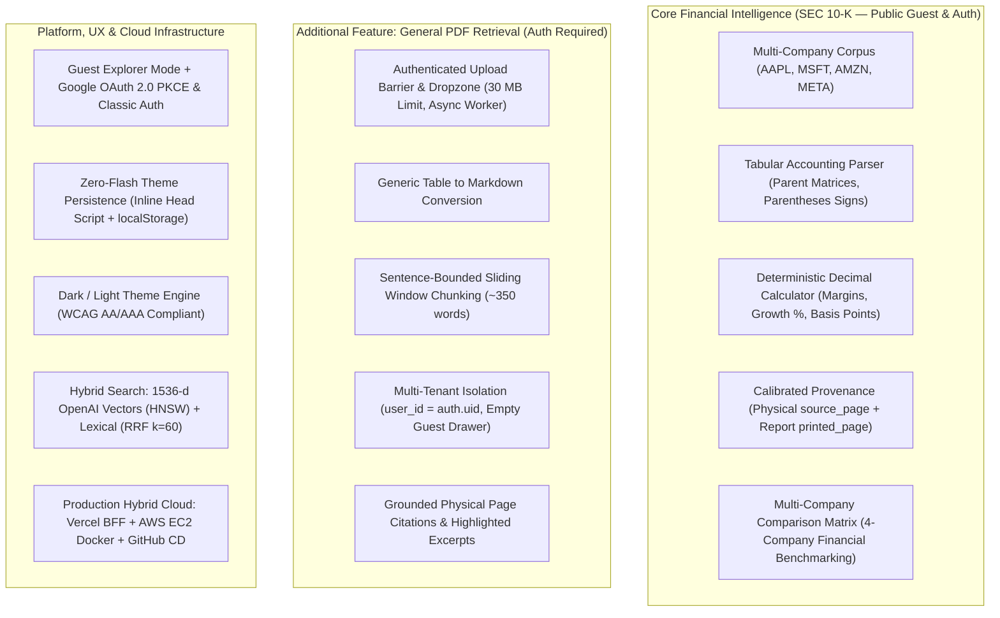

# 🟦 Trd.md — What the product must do

**Financial Report Analysis Assistant & Document Intelligence Platform** · v1.10 · 25 November 2026

> 🟩 **Production application operational across core, multi-tenant, and cloud deployment tiers.** Multi-company SEC 10-K extraction (AAPL, MSFT, AMZN, META), zero-friction **Guest Explorer Mode** for public SEC 10-Ks paired with strict authenticated isolation (`user_id = auth.uid()`) for custom PDF uploads, 3-layer microservice authentication (Next.js SSR + FastAPI JWKS + Supabase RLS), OpenAI `text-embedding-3-small` (1536-dim) hybrid retrieval (Dense + Lexical RRF $k=60$, $top\_k=10$), deterministic Decimal calculation engine, calibrated physical-to-printed PDF page alignment (`DEC-070`), zero-flash theme persistence (`DEC-069`), 20-case benchmark baseline (100% pass, 100% zero-hallucination rate), and a **60-case unit test suite** are fully operational across **Vercel + AWS EC2 + Supabase**.

[Requirements](Trd.md) · [Architecture](Architecture.md) · [Rules](rules.md) · [Phases](phases.md) · [Memory](memory.md)

---

## 1. Product in one minute

| Question | Answer |
|---|---|
| **What are we building?** | An audited financial intelligence platform with cited answers, verified arithmetic ledgers, interactive PDF provenance, and a **general document parser** for arbitrary user PDFs. |
| **Who uses it?** | Equity research analysts, investment bankers, auditors, and guest explorers reviewing SEC filings or private internal documents. |
| **Primary Corpus** | 11 official SEC Form 10-K annual reports for Apple Inc., Microsoft Corporation, Amazon.com, Inc., and Meta Platforms, Inc. (FY2022–FY2025). |
| **Guest vs. Authenticated Access** | **Guest Explorer Mode**: Anyone can freely query the 11 public SEC 10-K filings, run comparison matrices, and inspect PDF citations without logging in. **Signed-In Analysts**: Unlock custom PDF uploads (`UploadModal`) scoped strictly to their account (`My Uploaded Documents` is empty for guests and new accounts). |
| **Additional Feature** | **General PDF Document Parser & Retrieval Engine**: Allows authenticated users to upload arbitrary PDFs (contracts, research notes, invoices, policies), generate 1536-dim semantic chunks, and query them with grounded physical page citations. |
| **Main Risk** | Hallucinated figures, mismatched fiscal periods, wrong table units, unverified arithmetic, or misaligned PDF page jumps producing unreliable audit trails. |
| **Authentication** | 3-Layer security: Next.js SSR session cookies, Google OAuth 2.0 PKCE / classic email-password, FastAPI Bearer JWT (`get_optional_user` for public exploration vs `get_current_user` for private uploads), and Supabase Row Level Security. |

---

## 2. Feature Matrix

---

## 3. Evidence Contract

Every retrieved piece of information must adhere to strict provenance requirements:

### A. SEC 10-K Financial Evidence
* **Document**: Company name, ticker, report type (`10-K`), fiscal year, period ended, verified filing date, SHA-256 hash.
* **Table Cell**: Cell coordinate, row/col headers, raw value string, normalized Decimal, period label, unit ($M), footnote text.
* **Calculation**: Derived metric name, formula, exact operands, source pages, raw Decimal result, display rounding.
* **Page Alignment**: Must return both `printed_page` (report footer) and calibrated 1-based physical PDF sheet `source_page` (extracted strictly via `P(\d+)` without colliding with `-10K` prefixes).

### B. General Document Evidence (Additional Feature)
* **Document**: Title, uploaded file name, `user_id` (owner), `doc_type = 'general'`, total page count, upload timestamp.
* **Chunk**: Bounded narrative text or markdown table row group, physical page number (`source_page`), chunk ID, 1536-dim vector embedding.
* **Citation**: Verbatim excerpt quote, document title, physical page number (`source_page`), verified similarity score.
* **Isolation Rule**: General documents and user uploads belong strictly to the uploading `user_id`; guests and other users never see or retrieve another tenant's uploaded documents.

---

## 4. Supported Financial Calculations (Core Engine)

| Metric | Formula | Example Result |
|---|---|---|
| **YoY Revenue Growth %** | `(current − prior) / prior × 100` | `+2.02%` |
| **Operating Margin %** | `operating income / net sales × 100` | `31.51%` |
| **Gross Margin %** | `gross profit / net sales × 100` | `46.21%` |
| **Net Profit Margin %** | `net income / net sales × 100` | `23.97%` |
| **Margin Change (pp)** | `current margin % − prior margin %` | `+1.69 percentage points` |
| **Margin Change (bps)** | `percentage-point change × 100` | `+169 basis points` |
| **Dollar Variance** | `current value − prior value` | `+$7,754 million` |

* All arithmetic operations are executed in Python using **`Decimal`** with `ROUND_HALF_UP` precision.
* The LLM is **never allowed** to calculate arithmetic; it only identifies operands, which the backend calculator verifies and computes.

---

## 5. API & UI Specifications

### Authentication & Microservice Routes

| Method | Endpoint | Protection | Description |
|---|---|---|---|
| `GET` | `/health/live` | Public | FastAPI service liveness probe (zero DB/LLM overhead). |
| `GET` | `/health/ready` | Public | Database connectivity & readiness probe. |
| `GET` | `/api/v1/auth/me` | Authenticated (HTTP 401 if guest) | Returns verified Supabase user claims from JWT. |
| `GET` | `/api/v1/documents` | Optional Auth | Guests receive ONLY curated public SEC 10-Ks; authenticated users also receive their own uploads. |
| `GET` | `/api/v1/documents/{id}/status` | Optional Auth | Polls live chunk parsing and embedding progress for async uploads. |
| `GET` | `/api/v1/documents/{id}/pdf_url` | Optional Auth | Generates time-limited signed URL for in-canvas PDF viewing. |
| `POST` | `/api/v1/query` | Optional Auth | Executes grounded financial query or scoped general document question. |
| `POST` | `/api/v1/documents/upload` | **Authenticated (HTTP 401 if guest)** | Ingests arbitrary user PDF asynchronously via `BackgroundTasks` (HTTP 202 Accepted). |

### UI Design, Persistence & Accessibility Standards
* **WCAG Contrast:** Strictly complies with WCAG AA ( $\ge 4.5:1$ ) and AAA ( $\ge 7:1$ ) contrast ratios in both light and dark modes.
* **Zero-Flash Theme Persistence:** Inline synchronous `<head>` script in `layout.jsx` reads `docintel_theme` before hydration; unified `useEffect` cleanup in `page.jsx` preserves theme and settings across page reloads.
* **Component Modularity:** Organized into `workspace/`, `modals/`, `auth/`, and `hooks/`.
* **Zero UI Bloat:** Pure vanilla CSS custom properties; no heavy external component frameworks.
* **Dual-Badge Provenance:** Clicking any citation pill opens `PdfViewerModal.jsx` at the exact 1-based physical sheet (`#page=${source_page}`) and displays `PAGE {currentPage} (Report P. {printed_page})` whenever cover/TOC pages create an offset.
