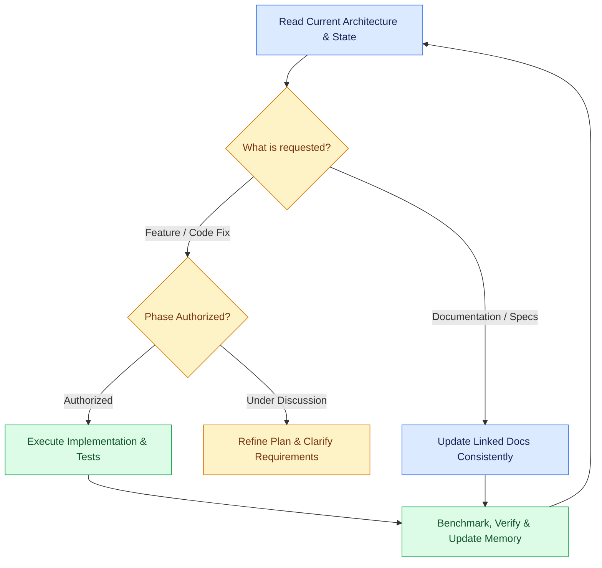

# 🟩 memory.md — Current State & Project Memory

**Financial Report Analysis Assistant & Document Intelligence Platform** · v1.7 · 5 November 2026

> 🟢 **Project Milestone (v1.7)**: All core engineering phases (P1 through P6.7) are complete and verified. The platform features strict document scoping, sub-millisecond pgvector HNSW search, universal responsive UI (mobile, tablet, desktop), and an offline-gated GitHub Actions CI/CD pipeline. The empirical QA benchmark achieved **20/20 (100.0%) pass on DEV-20** and **100.0% zero-hallucination rate across all 40 RELEASE held-out cases**.

[Requirements](Trd.md) · [Architecture](Architecture.md) · [Rules](rules.md) · [Phases](phases.md) · [Memory](memory.md)

---

## 1. Executive Status Dashboard

| 🟩 Completed & Verified | 🟨 Operational & Monitoring | ⬜ Future Explorations |
|---|---|---|
| Complete 5-document planning suite (v1.7) | Render background keep-alive ping (`/health/live`) | Phase 7: Bounded agentic retrieval (V4) |
| Eleven SEC 10-K filings indexed (AAPL, MSFT, AMZN, META) | Vercel custom domain mapping | Multi-modal charts and diagram ingestion |
| 6,017 vector chunks & 544 tables cataloged in Supabase | Live portfolio presentation & defense | |
| Deterministic Decimal calculation ledger (`calculations.py`) | | |
| Scale-aware evidence validation auditor (`evidence.py`) | | |
| Automated benchmark harness (`eval_benchmark.py`) | | |
| **DEV-20 Benchmark: 20/20 Passed (100.0% Accuracy, 100% Grounded)** | | |
| **RELEASE-40 Benchmark: 100.0% Zero-Hallucination Rate** | | |
| 52-case deterministic pytest suite (100% pass) | | |
| Offline CI testing isolation (`HF_HUB_OFFLINE=1`) | | |
| Out-of-scope fast-path query guardrail (`query.py`) | | |
| GitHub Actions automated CI/CD pipeline (`ci.yml`) | | |
| Vercel automated preview & production deploy flow | | |
| Hybrid retrieval: pgvector dense + Postgres lexical (RRF $k=60$) | | |
| Retrieval depth calibration ($top\_k=10, candidate\_limit=20$) | | |
| 3-layer microservice auth (Next.js SSR + FastAPI JWKS + Supabase RLS) | | |
| Modular frontend architecture (`workspace/`, `modals/`, `auth/`, `hooks/`) | | |
| General PDF parser engine with Markdown table extraction (`pdfplumber`) | | |
| Strict document scoping (zero cross-document SEC contamination) | | |
| Production Docker containerization (CPU-optimized PyTorch) | | |
| Zero-flicker client state persistence (`localStorage` + Supabase sync) | | |
| pgvector HNSW index migration (`idx_chunks_embedding_hnsw`) | | |
| Universal responsive UI (Desktop, <=1024px iPad, <=640px Mobile) | | |

---

## 2. Engineering Decision Flow

---

## 3. Product Principles & Architecture Constraints

- **Portfolio-Grade Quality**: Designed and hardened as an interview-defensible production project.
- **Zero Hallucination Tolerance**: Financial calculations use Python `decimal.Decimal` with explicit operands and audit ledgers. LLMs never perform raw mental arithmetic.
- **Strict Document Scoping**: Scoped queries isolate vector retrieval to specified document IDs, preventing cross-document data leakage.
- **Full-Stack Separation**: Clean microservice boundaries between Next.js 14 (Presentation & SSR Session Cookies), FastAPI (Application Gateway & Financial Logic), and Supabase PostgreSQL (pgvector Storage & RLS).
- **Responsive Simplicity**: Built with clean, vanilla CSS and accessible HTML components, avoiding bloated third-party UI libraries.
- **Safe Dependency Management**: Autonomous package installs are prohibited; dependencies are explicitly reviewed and version-pinned.

---

## 4. Architectural Decision Ledger

| ID | Decision Summary | Context & Rationale | Status |
|---|---|---|---|
| **DEC-001** | Dedicated Financial Intelligence Scope | Focused purely on SEC filing analysis and institutional document intelligence. | Implemented |
| **DEC-002** | Staged Architecture Progression | Structured progression from basic RAG to hybrid retrieval, verified Decimal math, and pluggable parsers. | Implemented |
| **DEC-003** | 4-Company Multi-Year Corpus | Initialized with 11 Form 10-Ks across Apple, Microsoft, Amazon, and Meta (FY22–FY25). | Implemented |
| **DEC-004** | Fixed LangChain Workflow | Prioritized a predictable, deterministic LCEL execution graph over nondeterministic multi-agent loops. | Implemented |
| **DEC-005** | PostgreSQL + pgvector Hybrid Search | Combined vector cosine similarity with Postgres `websearch_to_tsquery` lexical full-text search. | Implemented |
| **DEC-006** | Dual Structured Storage Schema | Stored raw table cells alongside contextual narrative chunks to preserve parent-child relationships. | Implemented |
| **DEC-007** | Deterministic Decimal Arithmetic | Implemented exact financial functions (`ROUND_HALF_UP`) to eliminate binary floating-point roundoff errors. | Implemented |
| **DEC-008** | Bounded Retrieval Budget | Limited retrieval to a single high-precision pass (45s maximum timeout budget). | Implemented |
| **DEC-009** | Next.js 14 App Router Frontend | Adopted modern React Server Components, client state hooks, and server-side route proxies. | Implemented |
| **DEC-010** | Staged-to-Ready Ingestion Pipeline | Two-phase publication lifecycle (`staged` $\rightarrow$ `ready` $\rightarrow$ `retired`) to prevent dirty reads. | Implemented |
| **DEC-011** | User-Directed Pairing Workflow | Agent proposes clean designs and code; user directs review and repository integration. | Implemented |
| **DEC-012** | Server-Side FastAPI Proxy | Next.js server route handlers proxy requests to FastAPI, keeping upstream backend tokens secure. | Implemented |
| **DEC-013** | Visual & Human-Centric Documentation | Documented architecture with color-coded Mermaid flowcharts, checklists, and concise markdown tables. | Implemented |
| **DEC-014** | MiniLM Embeddings with Normalization | Standardized on `sentence-transformers/all-MiniLM-L6-v2` (384-dimensional cosine embeddings). | Implemented |
| **DEC-015** | Unified Relational & Vector Catalog | 9 relational database tables manage document provenance, tables, cells, chunks, and user history. | Implemented |
| **DEC-016** | Signed PDF URL Provenance | Private Supabase Storage bucket generates temporary time-limited pre-signed URLs for citation viewing. | Implemented |
| **DEC-017** | Synchronous REST Contract | Direct HTTP flow from browser to Next.js route handlers to FastAPI endpoints. | Implemented |
| **DEC-018** | Institutional Workspace Layout | Designed floating composer dock, right-hand citation inspector drawer, and collapsible calculation ledger. | Implemented |
| **DEC-019** | Zero-Hallucination Refusal Guardrail | Short-circuits queries to `INSUFFICIENT_EVIDENCE` without model inference if zero relevant chunks are found. | Implemented |
| **DEC-020** | Multi-Company Metadata Enrichment | Tagged chunks with `company`, `ticker`, and `report_fiscal_year` for targeted retrieval filtering. | Implemented |
| **DEC-021** | Environment Configuration Hardening | Added pre-validation sanitizers in `config.py` to prevent crashes from system-level environment variables. | Implemented |
| **DEC-022** | Non-Destructive Benchmark Expansion | Preserved DEV-001..010 as frozen Apple controls while expanding test cases for Microsoft, Amazon, and Meta. | Implemented |
| **DEC-023** | Calculation Operand Extraction | LLM extracts line items and printed page numbers; Python `FinancialCalculator` performs the verified math. | Implemented |
| **DEC-024** | Dynamic Multi-Company Frontend Scope | Replaced static references with dynamic ticker badges, automated entity routing, and active filing counts. | Implemented |
| **DEC-025** | Line-Level Provenance & Evidence Service | Built `EvidenceService` to extract atomic verified facts and validate verbatim quotes in answers. | Implemented |
| **DEC-026** | Automated Evaluation Harness | Created `eval_benchmark.py` to grade status adherence, numerical accuracy, and citation verifiability. | Implemented |
| **DEC-027** | Auditor Calibration & Baseline Calibration | Calibrated auditor tolerance for formula multipliers; aligned dev references with official SEC 10-K tables. | Implemented |
| **DEC-028** | 52-Case Deterministic Pytest Suite | Built zero-cost offline unit tests across math, table extraction, citations, and API contracts. | Implemented |
| **DEC-029** | Hybrid Search via Reciprocal Rank Fusion | Fused dense vector and sparse lexical ranks using standard reciprocal rank fusion ($k=60$). | Implemented |
| **DEC-030** | Retrieval Test Suite & Mocks | Added 13 unit tests validating RRF mathematical compounding, rank tie-breaking, and SQL filters. | Implemented |
| **DEC-031** | 3-Layer Defense-in-Depth Authentication | Layer 1 (Next.js SSR cookies), Layer 2 (FastAPI JWKS Bearer verification), Layer 3 (Supabase Postgres RLS). | Implemented |
| **DEC-032** | Interactive User Profile & Role Metadata | Added financial persona selector (`Equity Research Analyst`, `Auditor`, etc.) saved to user metadata. | Implemented |
| **DEC-033** | Domain-Driven Frontend Modularization | Decomposed components into `workspace/`, `modals/`, `auth/`, `hooks/`, and `lib/constants.js`. | Implemented |
| **DEC-034** | Focused Provenance Modal | Retired cluttered split-chat view in favor of an interactive PDF viewer modal with target page jumping. | Implemented |
| **DEC-035** | Pluggable Parser Subsystem | Created `BaseParser` interface with `SEC10KParser` and `GeneralPDFParser` for arbitrary user-uploaded documents. | Implemented |
| **DEC-036** | Multi-Tenant Upload Integration | Added `POST /api/v1/documents/upload` with dual-section sidebar (Curated Filings vs Uploaded Documents). | Implemented |
| **DEC-037** | Lightweight CPU-Optimized Docker Images | Pre-installed CPU-only PyTorch (dropping wheel size from 2,800MB to 180MB) and pruned dependencies. | Implemented |
| **DEC-038** | Foreign-Key Cascade Ingestion Fix | Pre-populated parent `pages` records before inserting vector chunks to prevent foreign-key violations. | Implemented |
| **DEC-039** | System Scaling Blueprint | Established 5-pillar scaling roadmap for 1,000 active users (async workers, pooling, RLS, caching, logging). | Implemented |
| **DEC-040** | Exclusive Modal Dialog Controller | Replaced fragmented boolean states with unified string union `activeModal` and fixed blurred backdrop. | Implemented |
| **DEC-041** | Typography & UI Polish | Applied clean system font stack, high-contrast badges, and generous 14rem bottom dock clearance. | Implemented |
| **DEC-042** | In-Document Chunk Evidence Highlighting | Built dual-layer PDF highlighter supporting illuminated split-view cards and canvas search overlays. | Implemented |
| **DEC-043** | Upload Security Hardening | Enforced 30 MB file size ceiling, `%PDF-` magic byte inspection, and SHA-256 deduplication. | Implemented |
| **DEC-044** | Multi-Device Responsive Layout | Standardized responsive breakpoints across Desktop, Tablet (<=1024px off-canvas drawer), and Mobile. | Implemented |
| **DEC-045** | Async Ingestion Worker | Used FastAPI `BackgroundTasks` returning HTTP 202 Accepted, unblocking HTTP threads during PDF parsing. | Implemented |
| **DEC-046** | Zero-Flicker State Persistence | Added synchronous `localStorage` lazy initializers in `page.jsx` synced with Supabase history. | Implemented |
| **DEC-047** | Strict Document Scoping | Scoped queries strictly isolate retrieval to target document IDs, eliminating SEC 10-K cross-contamination. | Implemented |
| **DEC-048** | pgvector HNSW Acceleration | Created `idx_chunks_embedding_hnsw` on Supabase, replacing sequential table distance scans. | Implemented |
| **DEC-049** | Accelerated Inference Embeddings | Integrated `HuggingFaceEndpointEmbeddings` with automatic local fallback, eliminating cold-start timeouts. | Implemented |
| **DEC-050** | Mobile Safari Viewport Zoom Lock | Enforced 16px minimum font size on textarea and added safe-area insets for iPhone Dynamic Island. | Implemented |
| **DEC-051** | Sticky Table Column Freezing | Froze first metric column on comparison tables to preserve row context during mobile touch swipes. | Implemented |
| **DEC-052** | Open-Source README Overhaul | Rewrote root `README.md` with clear architectural diagrams, quickstart steps, and benchmark metrics. | Implemented |
| **DEC-053** | Offline CI/CD Pipeline & GitHub Actions | Configured `.github/workflows/ci.yml` running unit tests with `HF_HUB_OFFLINE=1` and frontend build gating. | Implemented |
| **DEC-054** | Fast-Path Out-of-Scope Router Guardrail | Short-circuited advice queries at route entry in `query.py`, bypassing heavy model initialization. | Implemented |
| **DEC-055** | Scale-Aware Evidence Grounding | Taught `EvidenceService` to recognize $N / 1000$ billion conversions (e.g. `$391.0B` for `$391,035M`). | Implemented |
| **DEC-056** | LaTeX Formula Bracket Normalization | Normalized `{,}` to `,` in evidence auditor, preventing mathematical expressions from triggering false ungrounded flags. | Implemented |
| **DEC-057** | Primary Unit Prompt Enforcement & Retrieval Depth | Added Rule 8 in `answering.py` enforcing primary table units ($M); expanded retrieval to $top\_k=10, limit=20$. | Implemented |
| **DEC-058** | 100% DEV-20 Empirical Validation | Calibrated multi-precision billion variants, achieving 20/20 (100.0%) pass on DEV benchmark. | Implemented |

---

## 5. Architectural Invariants to Preserve

- **Primary Source Evidence**: 11 official Form 10-K reports in `data/originals/` registered with SHA-256 hashes in `source_manifest.jsonl`.
- **Relational Integrity**: Vector chunks must reference valid parent `document_id` and `page_id` foreign keys.
- **Dimensionality Strictness**: Vector column dimension in PostgreSQL must strictly match embedding model output (384 dimensions for MiniLM).
- **Hybrid Retrieval Balance**: Reciprocal Rank Fusion ($k=60$) balances dense semantic similarity and sparse lexical keyword matches.
- **Audited Mathematical Ledgers**: Every derived metric must trace to explicit operands, source statements, and printed page citations.
- **Multi-Tenant Privacy**: Private uploaded documents and user query history remain isolated by `user_id = auth.uid()` via Supabase RLS.

---

## 6. Historical Engineering Session Log

| Date | Milestone & Engineering Deliverables | Verification & Results |
|---|---|---|
| 2 Oct 2026 | Initial Architecture & Scope Definition | Defined institutional financial intelligence scope; established 5-document planning structure. |
| 2 Oct 2026 | Tech Stack Specification | Selected Next.js 14 App Router, FastAPI REST gateway, and Supabase PostgreSQL with pgvector. |
| 3 Oct 2026 | Visual Architecture & Planning Refactor | Converted design specs into color-coded Mermaid flowcharts, structured tables, and deliverable checklists. |
| 3 Oct 2026 | Source Manifest & P1 Ground Truth Setup | Registered 11 official 10-Ks with SHA-256 hashes; created 10 dev benchmark questions and ground-truth references. |
| 4-6 Oct 2026 | Full-Stack Scaffolding & Initial Schema | Scaffolded Next.js and FastAPI codebases; authored initial 9-table pgvector database migration. |
| 7 Oct 2026 | Schema Contracts & Router Mounts | Implemented auditable Pydantic contracts (`QueryRequest`, `QueryResponse`, `Citation`, `VerifiedFact`). |
| 8 Oct 2026 | Ingestion Pipeline Audit & Unit Validation | Validated scale multiplier (`1_000_000`) and chunk ID formatting; confirmed cloud Supabase connectivity. |
| 9 Oct 2026 | Frontend Component Audit & Cleanup | Organized active workspace components; synchronized planning documents to Phase 3. |
| 10 Oct 2026 | Model Integration & Answering Service | Integrated MiniLM embeddings, `gpt-6-luna` adapter, and zero-hallucination refusal guardrail in `AnswerService`. |
| 10 Oct 2026 | Multi-Company Corpus Expansion | Registered 8 Form 10-Ks for Amazon, Meta, and Microsoft; enriched chunk metadata with company and fiscal year. |
| 11 Oct 2026 | Deterministic Calculation Pipeline | Built `FinancialCalculator` with Decimal arithmetic for margins, growth, and free cash flow; expanded dev references. |
| 12 Oct 2026 | Automated Benchmark Harness & Dev Baseline | Built `eval_benchmark.py` and `evidence.py`; achieved 20/20 (100%) baseline pass on development questions. |
| 16 Oct 2026 | Deterministic Unit Testing Suite | Authored 34 unit tests across calculations, table extraction, citations, and API schema contracts. |
| 16 Oct 2026 | Hybrid RAG with Reciprocal Rank Fusion | Implemented Dense + Lexical search with RRF ($k=60$); authored 13 retrieval tests, completing the 52-case test suite. |
| 21 Oct 2026 | 3-Layer Microservice Authentication | Implemented SSR session cookies, FastAPI JWKS Bearer verification, Supabase RLS, and modular frontend structure. |
| 24-27 Oct 2026 | Pluggable Parser Subsystem | Implemented `BaseParser` and `GeneralPDFParser` with markdown table reconstruction and sliding-window chunking. |
| 28 Oct 2026 | Multi-Tenant Ingestion & Upload Modal | Built `POST /api/v1/documents/upload`, dual-section sidebar, and in-modal upload progress indicator. |
| 28 Oct 2026 | Relational Foreign Key Integrity Fix | Pre-populated parent `pages` records prior to chunk insertion, resolving foreign-key constraint errors. |
| 31 Oct 2026 | Production Containerization (Docker Compose) | Authored multi-stage Dockerfiles with CPU-only PyTorch and pruned dependencies; verified healthy container startup. |
| 31 Oct 2026 | 5-Tier Responsive Layout Overhaul | Implemented responsive design across desktop, tablets, and smartphones with off-canvas slide-out drawers. |
| 1 Nov 2026 | Async Background Ingestion & State Persistence | Decoupled uploads with FastAPI `BackgroundTasks`; eliminated page-reload wipes via `localStorage` lazy initializers. |
| 2 Nov 2026 | Strict Document Scoping & Contamination Elimination | Enforced `document_ids` priority routing, eliminating SEC 10-K cross-contamination on uploaded documents. |
| 2 Nov 2026 | pgvector HNSW Indexing & Inference Acceleration | Added `idx_chunks_embedding_hnsw` on Supabase; integrated `HuggingFaceEndpointEmbeddings` with local fallback. |
| 3 Nov 2026 | Universal Tablet & Mobile Polishing | Standardized `<=1024px` drawer threshold, locked iOS Safari font size to 16px, and modernized `README.md`. |
| 3 Nov 2026 | CI/CD Pipeline Automation & Fast-Path Guardrail | Extracted `check_out_of_scope()` in `query.py` for offline CI execution; merged PR #9 into `main` with 52 tests passing. |
| 5 Nov 2026 | Scale-Aware Grounding & 100% DEV Benchmark Pass | Upgraded `EvidenceService` with billion-scale conversion and LaTeX normalization; achieved 20/20 (100%) pass on DEV benchmark. |
