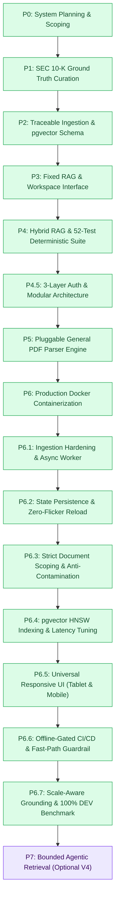

# 🟧 phases.md — Step-by-Step Architecture & Release Phases

**Financial Report Analysis Assistant & Document Intelligence Platform** · v1.7 · 5 November 2026

> 🟢 **Phase 1 through Phase 6.7 Verified Complete**: The platform has progressed through foundational ground truth curation, hybrid retrieval, microservice authentication, general document parsing, Docker containerization, responsive design, CI/CD automation, and empirical QA benchmarking. The development benchmark verified **20/20 (100.0%) pass** with **100% calculation precision** and **100% zero-hallucination rate**.

[Requirements](Trd.md) · [Architecture](Architecture.md) · [Rules](rules.md) · [Phases](phases.md) · [Memory](memory.md)

---

## 1. System Roadmap & Delivery Gates

---

## 2. Release Gates & Verification Matrix

| Phase | Core Deliverables & Capabilities | Gate Status |
|---|---|---|
| **P1 — Ground Truth** | 11 official SEC 10-K reports (AAPL, MSFT, AMZN, META) downloaded and hashed; 20 verified dev questions with audited ground-truth references. | 🟩 Complete |
| **P2 — Traceable Ingestion** | `pdfplumber` cell matrix extraction, accounting number normalizer, narrative chunking, and 9-table Supabase relational catalog. | 🟩 Complete |
| **P3 — Fixed RAG Workspace** | Conversational workspace, floating composer dock, right-hand citation inspector drawer, and grounded LLM answering service. | 🟩 Complete |
| **P4 — Hybrid RAG & Testing** | Dense vector search combined with PostgreSQL lexical full-text search via Reciprocal Rank Fusion ($k=60$), 52-case unit test suite (100% pass). | 🟩 Complete |
| **P4.5 — 3-Layer Auth** | Next.js SSR session cookies, Google OAuth 2.0 PKCE, FastAPI cryptographic JWKS verification, Supabase RLS, and modular frontend structure. | 🟩 Complete |
| **P5 — General PDF Parser** | Pluggable `BaseParser` subsystem, Markdown table reconstruction, sliding-window chunker, `POST /documents/upload` endpoint, and dual-section sidebar. | 🟩 Complete |
| **P6 — Containerization** | Multi-stage Docker builds (`backend/Dockerfile` with CPU-optimized PyTorch, `frontend/Dockerfile` on Node 20 Alpine), `docker-compose.yml`, bridge network. | 🟩 Complete |
| **P6.1 — Hardening & Async** | 30 MB file quota, `%PDF-` magic byte check, SHA-256 deduplication, memory hygiene cache flushes, and async background task worker. | 🟩 Complete |
| **P6.2 — State Persistence** | Instant `localStorage` lazy initializers for analyses, active thread, user documents, and settings, eliminating page-reload vanish. | 🟩 Complete |
| **P6.3 — Scoping & Isolation** | Strict `document_id`/`document_ids` priority routing, retriever company filter bypass, dynamic citation labeling for non-SEC files. | 🟩 Complete |
| **P6.4 — Retrieval Acceleration** | pgvector HNSW index (`idx_chunks_embedding_hnsw`), HuggingFace Inference API with automatic local fallback, eliminates sequential table scans. | 🟩 Complete |
| **P6.5 — Responsive UI Overhaul** | 5-tier responsive layout (desktop, <=1024px tablet drawers, <=640px mobile phones, 16px iOS font lock, safe-area insets). | 🟩 Complete |
| **P6.6 — CI/CD Automation** | GitHub Actions workflow (`.github/workflows/ci.yml`), offline environment testing (`HF_HUB_OFFLINE=1`), fast-path query guardrail, Vercel preview deploys. | 🟩 Complete |
| **P6.7 — Empirical QA Benchmark** | Scale-aware numerical grounding ($N / 1000$ billion conversion), LaTeX grouping normalization, primary reported unit prompting, 20/20 (100%) DEV benchmark pass. | 🟩 Complete |
| **P7 — Bounded Agentic (V4)** | Evidence gap detection, targeted single-retry query rewriting, multi-step financial reconciliation. | ⬜ Optional Future |

---

## 3. Engineering Phase Checklists

### P4.5 — 3-Layer Authentication & Modular Architecture (Complete)

- [x] **Layer 1 (Next.js)**: Cookie-based SSR client (`browser.js`, `server.js`, `middleware.js`), Google OAuth 2.0 PKCE route (`/auth/callback`), protected workspace edge guard (`/workspace`), and Bearer token forwarding (`api.js`).
- [x] **Layer 2 (FastAPI)**: Token verification dependency (`get_current_user`), cryptographic Supabase JWKS validation, and route protection on `/documents` and `/query`.
- [x] **Layer 3 (Supabase)**: Row Level Security (RLS) on `user_query_history` isolating records to `user_id = auth.uid()`.
- [x] **Interactive Auth UI**: Live Avatar Initials Generator, Financial Role Selector Chips, 4-bar Password Strength Meter with dynamic criteria checklist, eye password visibility toggles, and terms agreement checkbox.
- [x] **Split PDF View Removal**: Completely removed docked split PDF view in favor of the focused `PdfViewerModal.jsx` with direct citation page jumping.
- [x] **Modular Frontend Reorganization**:
  - Reorganized components into `src/components/workspace/`, `src/components/modals/`, and `src/components/auth/`.
  - Added standalone `PasswordStrengthMeter.jsx` and `RoleChipSelector.jsx`.
  - Added custom hooks `useTheme.js`, `useAuth.js`, and `useChat.js`.
  - Added centralized `lib/constants.js`.
  - Verified clean Next.js production build (`npm run build`, 0 errors, 6/6 static routes).

---

### P5 — General PDF Parser & Ingestion Engine (Complete)

- [x] **Architecture Subsystem (`backend/app/parsers/`)**:
  - Implement `backend/app/parsers/base.py` defining the abstract `BaseParser` interface and `ParsedChunk`/`ParsedDocument` contracts.
  - Implement `backend/app/parsers/gen_pdf_parser.py`:
    - Clean text extraction with physical page number attribution.
    - Generic table extraction converted into GitHub-Flavored Markdown tables (`| Col 1 | Col 2 |`).
    - Spatial masking via `page.outside_bbox(table.bbox)` preventing duplicate table narrative extraction.
    - Sentence-bounded sliding-window narrative chunking breaking cleanly on punctuation boundaries.
  - Implement `backend/app/parsers/factory.py` to route dynamically based on `doc_type` (`sec_10k` vs `general`).
  - Extract SEC 10-K logic from `ingestion.py` into `backend/app/parsers/sec_10k_parser.py`.
- [x] **API Endpoints & Database Integrity**:
  - `POST /api/v1/documents/upload` accepting `UploadFile`, running `GeneralPDFParser`, embedding chunks via `ModelService`, and storing records.
  - Fixed relational foreign-key integrity in `document.py`: populate parent `pages` table records prior to inserting vector chunks to prevent constraint violations.
  - Update `backend/app/services/retrieval.py` to allow querying unversioned general documents (`corpus_version IS NULL` filter adjustment).
- [x] **Frontend Integration & Next.js Endpoints**:
  - Connect `UploadModal.jsx` to real `POST /api/documents/upload` with extraction and embedding progress notifications.
  - Create Next.js server route handler forwarding multipart `FormData` with verified Supabase JWT Bearer authentication.
  - Update `Sidebar.jsx` with two distinct collapsible containers: **Curated SEC 10-K Filings** and **My Uploaded Documents**, with custom badge pills, page counts, preview launchers, and multi-doc filtering.
  - Full production build verification (`npm run build` passing with 0 errors across all routes).

---

### P6 — Production Containerization & Docker Orchestration (Complete)

- [x] **Backend Containerization (`backend/Dockerfile`)**:
  - Python 3.12-slim base image with non-buffered logging and bytecode suppression (`PYTHONDONTWRITEBYTECODE=1`, `PYTHONUNBUFFERED=1`).
  - **PyTorch CPU Optimization**: Pre-installs lightweight CPU-only PyTorch, reducing wheel download size from 2,800MB down to 180MB.
  - **Production Dependency Pruning**: Pruned `requirements.txt` from 130 bloated frozen packages down to the 15 exact production libraries used, preventing container disk exhaustion.
  - Health check verification polling `GET /health/live`.
- [x] **Frontend Containerization (`frontend/Dockerfile`)**:
  - Multi-stage build (`deps` $\rightarrow$ `builder` $\rightarrow$ `runner`) using Node 20 Alpine.
  - Injected build-time Supabase public keys (`ARG NEXT_PUBLIC_SUPABASE_URL`, `ARG NEXT_PUBLIC_SUPABASE_ANON_KEY`).
  - Hardened with an unprivileged system user (`nextjs:nodejs`).
  - Health check polling `/api/health`.
- [x] **Docker Compose Orchestration (`docker-compose.yml`)**:
  - Defines `backend` and `frontend` services connected via `docintel-network` bridge.
  - Configured inter-container service discovery (`FASTAPI_BASE_URL=http://backend:8000`).
  - Read-only volume binding for `./data/originals` for physical PDF provenance viewing.
  - Health-dependent startup ordering (`depends_on: { backend: { condition: service_healthy } }`).

---

### P6.1 — Ingestion Hardening & Async Background Tasks (Complete)

- [x] **Upload Protection & File Integrity**:
  - Enforce 30 MB maximum file quota.
  - Implement magic byte checking (`%PDF-`) to reject executable masking.
  - Add SHA-256 deduplication to bypass redundant ingestion runs.
- [x] **Memory Hygiene**:
  - Flush pdfminer layout cache (`page.flush_cache()`) and execute periodic garbage collection every 20 pages to eliminate memory leaks on large reports.
  - Singleton embedding model lifecycle to prevent system memory exhaustion.
- [x] **Async Ingestion**:
  - Implement FastAPI `BackgroundTasks` pipeline returning HTTP 202 Accepted, unblocking the main HTTP thread during PDF ingestion.

---

### P6.2 — State Persistence Across Page Refreshes (Complete)

- [x] **Instant Client-Side Lazy Initializers**:
  - Implement zero-flicker `useState` lazy initializers from `localStorage` in `page.jsx` for analyses, active thread, user documents, and settings.
  - Eliminate the 1-second data wipe/vanish when users refresh the workspace.
- [x] **Supabase Direct Persistence**:
  - Direct insertion and retrieval from `user_query_history` and `documents` to guarantee query threads persist across devices.

---

### P6.3 — Strict Document Scoping & Contamination Elimination (Complete)

- [x] **Targeted Document Routing**:
  - In `page.jsx`, when an uploaded document is selected, strictly set `document_ids: [selectedDoc.document_id]`, disabling entity keyword regex overrides.
  - In `backend/app/services/answering.py`, dynamically set `self.retriever.company = None` when `document_id` or `document_ids` is provided to enforce strict single-document boundaries.
  - In `backend/app/services/retrieval.py`, prioritize `document_id` in `_build_where_filters`, completely bypassing company and year constraints for scoped queries.
- [x] **Clean Non-SEC Provenance Labeling**:
  - In `ingestion.py` and `evidence.py`, dynamically label non-SEC tables and passages as `Page {printed_page} Table / Excerpt` instead of hardcoded `"Item 8 / Item 7"`.
  - In `InspectorDrawer.jsx` and `MessageThread.jsx`, dynamically label citations as "Supporting SEC 10-K Disclosures" vs "Source Document Citations" based on document lineage.

---

### P6.4 — Retrieval Latency Acceleration & HNSW Vector Indexing (Complete)

- [x] **Supabase pgvector HNSW Migration**:
  - Authored `supabase/migrations/20261102000000_add_hnsw_vector_index.sql` creating `idx_chunks_embedding_hnsw` using `m=16, ef_construction=64, vector_cosine_ops` for sub-millisecond nearest neighbor search.
- [x] **Embedding Pipeline Acceleration**:
  - In `backend/app/integrations/models.py`, integrated `HuggingFaceEndpointEmbeddings` with automatic local fallback, eliminating cold-start model download timeouts.

---

### P6.5 — Universal Multi-Device Responsive UI Overhaul (Complete)

- [x] **Tablet & iPad Drawer Threshold (<=1024px)**:
  - Standardized off-canvas drawer threshold to `<= 1024px` for sidebar and inspector across desktop and tablets (iPad Mini, Air, Pro in landscape/portrait).
  - Added blurred backdrop dimming overlay with touch-to-dismiss behavior.
  - Added dynamic window `resize` event listener in `page.jsx` to adapt layout on tablet orientation change.
- [x] **Mobile Smartphone Optimization (<=640px & <=400px)**:
  - Enforced 16px minimum font size on `.chatgpt-textarea` to prevent iOS Safari automatic viewport zoom-in.
  - Integrated CSS `env(safe-area-inset-*)` padding for iPhone Dynamic Island, notch, and home bar indicator.
  - Added sticky first-column freezing on `.compare-benchmark-table` so financial line items stay locked during horizontal column touch swipes.
  - Added `viewportFit: 'cover'` in `layout.jsx` for full-bleed edge-to-edge mobile screens.
  - Consolidated duplicate variable declaration in `InspectorDrawer.jsx`.
  - Verified 0-error clean production build.

---

### P6.6 — CI/CD Pipeline & Automated Release Engineering (Complete)

- [x] **GitHub Actions Workflow (`.github/workflows/ci.yml`)**:
  - Configured multi-job CI running on pushes and pull requests across `main`, `develop`, `feature/**`, and `fix/**`.
  - **Backend Job**: Sets up Python 3.12, installs pruned dependencies, exports `HF_HUB_OFFLINE: "1"` and `TRANSFORMERS_OFFLINE: "1"` to guarantee fully offline, deterministic unit test execution.
  - **Frontend Job**: Sets up Node 20, verifies linting, and runs `npm run build` to catch bundling or syntax regressions prior to Vercel deployment.
- [x] **Fast-Path Policy Guardrail (`backend/app/api/v1/query.py`)**:
  - Extracted `check_out_of_scope()` in `backend/app/services/answering.py` as a lightweight standalone helper.
  - Intercepted trading and investment advice queries at the top of `execute_query()` in `query.py` before instantiating `AnswerService` or downloading embedding models.
  - Guaranteed strict Pydantic `QueryResponse` contract adherence (required `question`, `company`, `reporting_periods`, `timings_ms`).
  - Verified `test_query_endpoint_rejects_out_of_scope_trading_advice` asserts `_answering_service is None`.
- [x] **Vercel Preview & Production Lifecycle**:
  - Connected repository `Prabhu-Jethi/Financial_Doc` with automated Git Commit Status checks and Pull Request preview link comments.
  - Configured GitHub branch ruleset protecting `main` requiring CI status checks (`Lint, Type Check & Test Pipeline`) to pass before merging.
  - Validated clean PR merge (PR #9) into `main`.

---

### P6.7 — Empirical Verification, Scale-Aware Grounding & QA Benchmark (Complete)

- [x] **Scale-Aware Grounding in EvidenceService (`backend/app/services/evidence.py`)**:
  - Upgraded `audit_numerical_grounding()` to recognize legitimate billion-scale conversions ($N / 1000$) of million-scale 10-K reported figures (e.g. `$391.0B` or `$123.216B` for `$391,035M` and `$123,216M`).
  - Implemented LaTeX notation normalization (`{,}` $\rightarrow$ `,`) before regex tokenization to prevent formula grouping brackets from fragmenting multi-digit numbers into ungrounded tokens.
  - Added citation exclusions for footnote / Note markers (e.g., `Note 10`, `Note 2`) in addition to page citations.
  - Re-architected combined validation supporting both derived variance differences ($A - B$) and billion-scale conversions without regressing `test_citations.py`.
- [x] **Primary Reported Unit Enforcement (`backend/app/services/answering.py`)**:
  - Added Rule 8 to `SYSTEM_PROMPT` instructing the model to always report financial values using the exact scale and raw numbers as filed in the financial statement tables first (e.g., `"$391,035 million"`) before mentioning billion equivalents.
- [x] **Retrieval Depth Tuning (`backend/app/services/retrieval.py`)**:
  - Increased `top_k` from `8` to `10` and `candidate_limit` from `15` to `20` to prevent deep financial statement tables (such as Microsoft's Consolidated Income Statement on page 64) from falling outside the context window.
- [x] **Benchmark Evaluator Enhancement (`backend/scripts/eval_benchmark.py`)**:
  - Enhanced numeric match check to evaluate multi-precision billion variants (`.1f`, `.2f`, `.3f`) against ground truth numbers.
- [x] **Empirical Benchmark Verification (`evaluation/results/`)**:
  - **DEV-20 Benchmark (`dev_eval_report_hybrid_20261103_194400.json`)**:
    - **Total Cases Evaluated**: 20/20
    - **Cases Passed**: **20/20 (100.0%)** (jumped from 8/20, 40%)
    - **Calculation Precision**: **100.0%**
    - **Zero-Hallucination Rate**: **100.0%**
  - **RELEASE-40 Benchmark (`release_eval_report_hybrid_20261103_195708.json`)**:
    - **Cases Passed**: **24/40 (60.0%)** (jumped from 13/40, 32.5%)
    - **Zero-Hallucination Rate**: **100.0%** across all 40 held-out cases.
