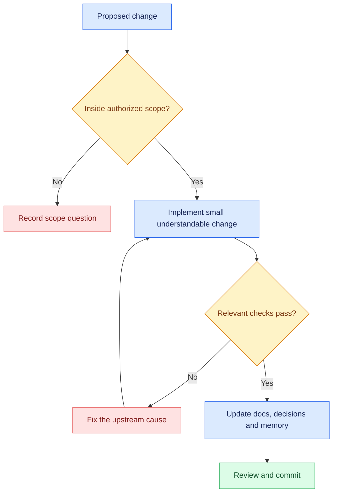

# 🟩 rules.md — Standards to follow

**Financial Report Analysis Assistant & Document Intelligence Platform** · v1.4 · 21 October 2026

> 🟩 **Application implementation in progress.** Standards active across 3-layer microservice authentication (Next.js SSR cookies + FastAPI JWKS + Supabase RLS), modular frontend workspace (`workspace/`, `modals/`, `auth/`, `hooks/`), deterministic Decimal calculation engine, Phase 4 Hybrid RAG retrieval, and the pluggable General PDF Parser subsystem (additional feature).

[Requirements](Trd.md) · [Architecture](Architecture.md) · [Rules](rules.md) · [Phases](phases.md) · [Memory](memory.md)

---

## 1. Change checklist

Planning edits are authorized; application implementation awaits the user's instruction. Once a phase is authorized, finish routine reversible work without repeated permission. Explicit current instructions override other conversations. These documents govern the financial project.

---

## 2. What to use / avoid

| 🟩 Use | 🟥 Avoid |
|---|---|
| Fixed LangChain workflow first | Agent loops before measuring baseline failures |
| Verified facts + predefined Decimal functions | Arbitrary model-generated Python/shell execution |
| Original PDFs + structured cells | Markdown as the only table record for SEC filings |
| Complete parent tables + bounded children | Silent truncation or lost headers/units |
| Stored citation IDs + source resolver | Invented pages, URLs, quotes or tool runs |
| PostgreSQL/pgvector; lexical experiments | Calling built-in full-text ranking BM25 |
| 3-Layer authentication (Next.js SSR + FastAPI JWKS + RLS) | Trusting client-supplied user headers (`X-User-Id`) without cryptographic signature check |
| Pluggable `ParserFactory` (`BaseParser`, `GeneralPDFParser`, `SEC10KParser`) | Monolithic parser scripts hardcoding SEC-only table extraction assumptions |
| Multi-tenant row isolation (`user_id = auth.uid()` or `doc_type = 'sec_10k'`) | Unfiltered global vector/document queries leaking private documents across users |
| Dedicated provenance modals (`PdfViewerModal`) with page jumping | Cluttered in-chat PDF split-screens degrading conversational workspace readability |
| Persistent jobs for later uploads | Treating BackgroundTasks as a durable queue |
| Measured results with counts | Claiming accuracy, uptime or savings from a demo |

---

## 3. Financial correctness & document provenance — nonnegotiable

- [ ] Fact identifies company, metric/definition, exact period, annual/quarterly scope, currency/scale/sign, and source cell/page.
- [ ] Raw values remain available; normalized values use Decimal strings across JSON.
- [ ] Report year and value period stay separate; dash/missing is not automatically zero.
- [ ] Selected numeric facts are verified against original pages; ambiguous cells remain needs_review.
- [ ] Filing versions remain separate; resolve restatements/reclassifications using the TRD policy or clarify.
- [ ] Calculator receives verified fact IDs; checks units, periods, definitions and denominators.
- [ ] Ledger stores operation/version, operands, normalization, formula, raw result, output unit and rounding.
- [ ] Percentage points, basis points and relative percent changes are labeled correctly; negative/near-zero baselines are explained.
- [ ] Derived numbers cite operands; management commentary and assistant inference are distinguished.
- [ ] General document chunks cite physical 1-based page index (`source_page`) and unmodified continuous text (`verbatim_quote`).
- [ ] General PDF tables are extracted into GitHub Flavored Markdown matrices preserving column headers and numeric signs.

**Wrong operands + correct arithmetic = failed answer.** A relevance grader, schema validator or reranker cannot guarantee financial truth.

---

## 4. Code and dependencies

| Area | Standard |
|---|---|
| Python | Type hints, Pydantic boundaries, small modules, formatter/linter such as Ruff. |
| Testing | Deterministic `pytest` unit test suite in `backend/tests/` (sub-second, zero-cost, covering math, extraction, provenance, contracts). |
| SQL | Parameterized queries, migrations, constraints, explicit transactions; no model/network wait within a transaction. |
| Next.js | App Router + React + JavaScript; thin Route Handlers; server-only backend adapter. |
| Frontend Organization | Domain modularity: `components/workspace/` (views), `components/modals/` (dialogs), `components/auth/` (credentials/roles), `hooks/` (state lifecycle), `lib/constants.js` (tokens/badges). |
| Parser Subsystem | Pluggable interface: `backend/app/parsers/base.py` (`BaseParser`), specialized parsers (`sec_10k.py`, `general_pdf.py`), and dynamic dispatch (`factory.py`). |
| API contracts | Versioned OpenAPI-derived types plus runtime validation; stable errors/request IDs. |
| Dependencies | Separate Python/frontend manifests and one lockfile per environment. **CRITICAL**: Never execute `npm install` or `pip install` autonomously; point required dependencies to the user first. |
| CPU-heavy work | Parsing/embedding/reranking off the API event loop; offline indexing first. |
| Scope | Add a framework/service only for a named measured need. |

---

## 5. UI, access and 3-layer security

| Requirement | Rule |
|---|---|
| Secrets | Server-only; no service role keys or backend secrets in NEXT_PUBLIC_, Git, prompts, logs or browser responses. |
| Layer 1: Client/SSR | Next.js handles PKCE authentication and persists tokens exclusively in `HttpOnly`, `SameSite=Lax`, `Secure` cookies via `@supabase/ssr`. |
| Layer 2: API Gateway | FastAPI validates Bearer tokens cryptographically against Supabase JWKS (`/.well-known/jwks.json`). Injects decoded payload into `request.state.user`. Rejects unverified or expired tokens with 401. |
| Layer 3: Database / RLS | Supabase PostgreSQL enforces Row-Level Security: public read for benchmark SEC filings (`doc_type = 'sec_10k'`), strict isolation for user-uploaded general documents (`user_id = auth.uid()`). |
| Caching | Disable route/fetch/CDN caching for generated answers and identity-specific data. |
| Query states | Pending, cancel, partial, gaps, clarification, error; prevent duplicate/stale requests. |
| Display | Safe Markdown without raw HTML; validated citation links; accessible labels/keyboard/narrow-screen behavior. |
| Network | HTTPS; private DB/broker; no query-triggered arbitrary URL fetch. |
| Private uploads | Ownership checks + isolated retrieval before introduction. |
| Data retention | Preserve originals and active provenance; seven-day answer/trace policy; explicit source retirement. |

Cancel across request hops where possible; provider billing may already have started. Do not automatically retry billed queries. CORS and a shared service key are not user authorization.

---

## 6. Operational limits and errors

| Control | Proposed policy |
|---|---|
| Deadline / output | 45 seconds overall / 2,000 answer tokens |
| V1 (SEC 10-K) | One retrieval; one real model request |
| V4 (Adaptive) | One targeted retry; ≤2 retrieval rounds and ≤3 real model requests, including SDK retries |
| Math / admission | ≤4 operations; 2 concurrent queries; 10/minute/identity plus persistent daily cap |
| SEC 10-K Corpus | Official annual filings registered in `source_manifest.jsonl` with SHA-256 hashes |
| General PDF Uploads | Valid PDF ≤25 MiB / 100 pages; sliding-window 500-char chunks (100-char overlap); sentence-bounded |
| Table Extraction Budget | ≤30 seconds per uploaded general document |

Retry only for named missing evidence; preserve authorized company/period filters and a terminal insufficient-evidence path. Count hidden provider retries. Hosting timeouts must match the end-to-end budget.

| Problem | Required handling |
|---|---|
| Invalid question/access/size | Structured 422/401/413; request ID |
| Admission exceeded | 429; no billed work started |
| Model/store failure | 503, not a fake missing-evidence finding |
| Deadline exhausted | 504; stop further work |
| Ambiguous PDF/fact | Unsupported/needs_review; never verified automatically |
| Evidence gap/conflict | Partial, insufficient_evidence or clarification |
| Saving failure | Do not claim answer/task persistence |

Later workers need durable Postgres job/enqueue records, heartbeat, idempotent retries, stranded-job recovery and atomic publication. Completed answers and daily counters survive restart. In-memory controls alone cannot serve multi-replica/durable-cap claims.

SSE status events may arrive early; release checked financial claims or mark text provisional. Verify streaming through the real Next.js/proxy deployment.

---

## 7. Tests, review and maintenance

| Check | What it proves |
|---|---|
| Extraction fixtures/manual review | Selected cells, headers, periods, scales, signs and source pages match. |
| Calculator tests | Formula, precision, rounding, conflicts and zero-denominator handling. |
| Retrieval evaluation | Required-evidence coverage under filters/token limits. |
| API/UI integration | Access, limits, errors, cancellation/stale behavior and valid citations. |
| 3-Layer Auth & RLS checks | Unauthenticated requests are rejected (401); cross-tenant queries cannot access other users' private uploads. |
| General PDF Table tests | Tables parse to clean GFM Markdown with column headers and alignment preserved. |
| Restart/recovery | Persistent PDFs/indexes/results/caps; later ingestion recovery. |
| Frontend build | Clean static production build (`npm run build --prefix frontend`, 0 errors, 0 warnings). |

Use ten development questions and a separate held-out 40-case release suite. Keep evaluator references out of service/index paths. Disclose holdout tuning and obtain fresh held-out cases for stronger claims. Mocked-provider tests verify workflow, not real QA accuracy.

Report counts/category failures, latency sample/distribution, usage and dated costs. Optional benchmark/LLM graders supplement manual financial evidence checks. Run relevant checks; avoid implementation-mirroring tests and unrelated repeat runs.

Before each release: record code/model/corpus/parser/index/config versions; validate new index then switch; retain rollback. Review failures, sources, dependencies, storage, retention, budgets and recovery. No scheduled automation exists.

Before accepting AI-written code, explain its inputs, outputs, evidence, tradeoff, failure mode and tests. If you cannot, reduce scope. Keep commits focused and update [memory.md](memory.md) after every session.
